# GIÁO TRÌNH TỪ A ĐẾN Z: TOÀN BỘ HỆ THỐNG SCRIPT DỰ ÁN PADS (SURVIVAL & LUCKY CHEST)

> **Đối tượng người học:** Người đã biết lập trình cơ bản (biến, hàm, điều kiện `if/else`, vòng lặp `for`, mảng/danh sách) và muốn hiểu **toàn bộ 100% kiến trúc code của dự án Playable Ads 3D trên Cocos Creator 3.8.8** (`Survival` và `Lucky Chest`), hiểu cách các script phối hợp với nhau, cách gắn lên Scene và cách tự tay chỉnh sửa game.

---

## MỤC LỤC NHANH

1. [PHẦN 1: Bức tranh toàn cảnh dự án (74 file script & 5 scene)](#phần-1-bức-tranh-toàn-cảnh-dự-án)
2. [PHẦN 2: Kiến thức nền tảng Cocos Creator & TypeScript để đọc hiểu code](#phần-2-kiến-thức-nền-tảng-cocos-creator--typescript)
3. [PHẦN 3: Lớp Hệ thống dùng chung (`System/`, `UI/`, `VFX/`, `ADS/`)](#phần-3-lớp-hệ-thống-dùng-chung-system-ui-vfx-ads)
4. [PHẦN 4: Chế độ SURVIVAL — Phân tích từng script & luồng gameplay](#phần-4-chế-độ-survival-survivalscene)
5. [PHẦN 5: Chế độ LUCKY CHEST — Kiến trúc mô-đun & từng dòng chảy 3 phòng](#phần-5-chế-độ-lucky-chest-lchscene--16-script-mô-đun)
6. [PHẦN 6: Hai bộ công cụ phụ (`Skin/` vẽ UI bằng code & `Test/` thử nghiệm ban đầu)](#phần-6-hai-bộ-công-cụ-phụ-skin-và-test)
7. [PHẦN 7: Sổ tay thực hành — Muốn chỉnh game thì sửa ở đâu & các "bẫy" cần tránh](#phần-7-sổ-tay-thực-hành--muốn-chỉnh-game-thì-mở-đâu--các-bẫy-cần-tránh)

---

## PHẦN 1: Bức tranh toàn cảnh dự án

Dự án này chạy trên **Cocos Creator 3.8.8**, dùng ngôn ngữ **TypeScript** (bản chất là JavaScript có thêm kiểu dữ liệu như `number`, `string`, `boolean`, `Node`, `Vec3` để tránh viết nhầm kiểu và gợi ý code tốt hơn). Mục đích của dự án là làm **Playable Ads** (quảng cáo chơi thử dạng web HTML5 chạy nhẹ, mượt trên điện thoại).

Trong thư mục `assets/Scene/` có 5 file scene:
- **`Survival.scene`**: Màn chơi sinh tồn (chiến đấu giữa đảo đá, liên tục sinh 20–30 quái, lên 3 mốc level chọn thẻ kỹ năng, cuối cùng tung chiêu **Holy Retribution** quét sạch toàn bộ bản đồ rồi hiện màn quảng cáo tải game `AD`).
- **`LCH.scene`** (*Lucky Chest*): Màn chơi đi qua **3 phòng ngục cổ**, đánh quái theo từng phòng (Melee + Mage bắn cầu lửa), hạ hết quái thì rương rơi xuống mở ra nâng cấp vũ khí (`dagger` -> `axe_Tier2` 4★ -> `two_handed_axe_Tier2` 5★), chạm phải rương bẫy phòng 3 bị 18 con quái hóa khổng lồ 2x tràn vào hạ gục rồi hiện `AD`.
- **`Test.scene`**, **`selectskill.scene`**, **`UITest.scene`**: Các scene phụ dùng để thử animation, camera, joystick hoặc xem trước popup chọn skill trong lúc phát triển.

### 1.1. Bản đồ 11 thư mục trong `assets/Scripts/` (Tổng cộng 74 file `.ts`)

| Thư mục | Số file | Dùng cho Scene nào? | Nhiệm vụ chính |
|---|---:|---|---|
| `Config/` | 4 | **Survival** | Chứa các bảng số để bạn cân bằng game ngoài Inspector (máu Hero, sát thương, tốc độ spawn, mốc kill lên cấp, danh sách skill). |
| `Char/` | 7 | **Survival** | Toàn bộ não bộ của Paladin: di chuyển, rẽ đám đông, chém quạt, xoay vòng hào quang Aura, HP, EXP, lưu skill đã học. |
| `Enemies/` | 7 | **Survival** | Toàn bộ vòng đời quái Skeleton Melee: đẻ quái, tái chế Pool, tự tìm Hero, tách đàn, chém, nhận sát thương, chết. |
| `Cam/` | 1 | **Survival** | `CamFollow.ts` — Camera chạy mượt theo nhân vật và tự nới FOV cho màn hình dọc. |
| `System/` | 7 | **Cả 2** *(riêng `GameManager`, `DmgDealer`, `IslandWallCollision` chỉ dùng Survival)* | Bộ máy lõi: Kênh sự kiện (`EventManager`), Âm thanh (`AudioManager`), Số sát thương bay lên (`DamageTextManger`), Pool, va chạm tường đảo. |
| `UI/` | 13 | **Cả 2** *(thẻ `Skill*` dùng cho Survival; `ExpBar` dùng cho cả 2)* | Joystick, bàn tay hướng dẫn, thanh máu/EXP, nút quảng cáo kết thúc (`ADCtrl`, `WinPopCtrl`), khóa hướng màn hình (`ResolutionAdapter`). |
| `VFX/` | 4 | **Cả 2** *(riêng `CharVFX`, `VFXManager` chỉ gắn ở Survival)* | Vẽ vòng sáng / vệt chém 3D bằng code (`PaladinGroundFx`), khói chân, tia lửa, hiệu ứng quái trúng đòn/chết (`EnemyVFX`). |
| `ADS/` | 2 | **Cả 2** | Nối game với các mạng quảng cáo thật (`AppLovin`, `Facebook`, `Google`, `Mintegral`, `Unity`, `Tiktok`, `IronSource`, `super_html`). |
| `LuckyChest/` | 16 | **Lucky Chest** | Kiến trúc mới chia nhỏ 16 file chuyên biệt cho `LCH.scene`: luồng 3 phòng, camera 3 góc, 4 cặp cửa, rương báu, popup nhận rìu, vật cản cột/bình vỡ, Mage cầu lửa. |
| `Skin/` | 9 | **Tiện ích bổ sung** *(chưa gắn vào Survival/LCH)* | Bộ thư viện tự vẽ nút bấm, khung viền, thanh máu, thanh máu Boss bằng HTML5 Canvas 2D mà không cần ảnh PNG. |
| `Test/` | 4 | **Test.scene** | Bộ script thử nghiệm ban đầu (test anim, test cam, joystick bản sơ khai, controller test). |

### 1.2. Sự khác biệt tư duy kiến trúc giữa Survival và Lucky Chest

Trước khi đọc sâu từng file, bạn hãy nhớ sự khác biệt quan trọng nhất giữa hai chế độ này:

1. **Cách chia nhỏ script:**
   - Ở **Survival**, `CharaterController.ts` (~510 dòng) và `CharacterCombat.ts` (~525 dòng) kiêm khá nhiều việc trong 1 file.
   - Ở **Lucky Chest**, code được **tách nhỏ thành 16 file ngắn gọn** theo đúng từng việc (*Single Responsibility*): ví dụ nhân vật Warrior tách làm 4 script (`LCHWarriorStats`, `LCHWarriorMove`, `LCHWarriorCombat`, `LCHWarriorAnim`); quái tách làm 3 script (`LCHEnemyStats`, `LCHEnemyMove`, `LCHEnemyCombat`).
2. **Cách tìm các Object (Node) trong Scene:**
   - **Survival** thường có đoạn code *"tự tìm"* trong `onLoad()`/`start()`, ví dụ `this.node.scene?.getChildByName('Character')` hoặc `getChildByPath('UI/AD')` nếu quên kéo thả trong Inspector.
   - **Lucky Chest** áp dụng nguyên tắc **"Zero Auto-Search" (Tuyệt đối không tự tìm kiếm hay tự sinh Component lúc chạy)**: Mọi kết nối (từ `GameManager` tới `Warrior`, 3 rương `Chest0..2`, 18 con quái, 4 cặp cửa, camera, UI) đều được kéo thả và gắn sẵn trực tiếp trong bảng Inspector của `LCH.scene`. Nhờ vậy dễ kiểm soát, không bao giờ lỗi vì đổi tên node ngầm.

```mermaid
flowchart LR
    subgraph Shared["Dùng chung Cả 2 Scene"]
        EM["EventManager.ts"]
        AM["AudioManager.ts"]
        DM["DamageTextManger.ts"]
        PM["PoolManager.ts"]
        UI["JoyStick / GuideHand / ADCtrl / WinPopCtrl / ExpBar / ResolutionAdapter"]
        ADS["PlayableAdsController + super_html_playable"]
        VFX["PaladinGroundFx + EnemyVFX"]
    end

    subgraph Surv["Chỉ dành cho Survival.scene"]
        SC["Config/* (4 file)"]
        SG["GameManager.ts + DmgDealer.ts + IslandWallCollision.ts"]
        SCH["Char/* (7 file) + CharVFX.ts"]
        SEN["Enemies/* (7 file) + HPBar / BarAttacher"]
        SSK["SkillPopUp / SkillCardView / SkillReelView / SkillPool / GuildHandSkill"]
        SCAM["CamFollow.ts"]
    end

    subgraph LCH["Chỉ dành cho LCH.scene (16 file LuckyChest)"]
        LF["LCHFlowManager.ts (Nhạc trưởng)"]
        LCFG["LCHConfig.ts"]
        LMAP["LCHCameraController + LCHDoorController + LCHRoomBoundary + LCHPropObstacle"]
        LW["LCHWarriorStats + LCHWarriorMove + LCHWarriorCombat + LCHWarriorAnim"]
        LEN["LCHEnemyStats + LCHEnemyMove + LCHEnemyCombat + LCHFireball"]
        LRW["LCHChest + LCHWeaponUpPopup"]
    end

    Surv --> Shared
    LCH --> Shared
```



---

## PHẦN 2: Kiến thức nền tảng Cocos Creator & TypeScript

Nếu bạn chỉ mới biết biến, hàm, `if/else`, vòng lặp `for` ở mức cơ bản, bạn chỉ cần nắm **7 khái niệm dưới đây** là đọc được toàn bộ 74 file trong dự án này.

### 2.1. `Node` và `Component` là gì?

- **`Node`** (Nút): Là mọi "đối tượng" có mặt trong cây **Hierarchy** (bên trái màn hình Cocos Creator), ví dụ `Main Camera`, `Character`, `Character_Warrior`, `Chest0`, `JoyStick`, `AD`. Bản thân `Node` chỉ có tên, trạng thái bật/tắt (`active`), vị trí (`position`), góc xoay (`rotation`), độ phóng đại (`scale`) và danh sách node con (`children`).
- **`Component`** (Thành phần): Là các "kỹ năng" hoặc "bộ phận" gắn lên `Node`. Một `Node` rỗng không làm gì cả nếu không gắn `Component`:
  - Muốn hiện mô hình 3D -> gắn `MeshRenderer` hoặc `SkinnedMeshRenderer`.
  - Muốn hiện hình 2D UI -> gắn `Sprite` + `UITransform`.
  - Muốn có hành vi lập trình -> viết một `class` kế thừa `Component` (`extends Component`) rồi gắn vào Node.

**Cách script lấy script khác trên CÙNG một Node:**
```ts
this.charAnim = this.getComponent(CharacterAnimation);
```
**Cách lấy từ Node con hoặc từ `Node` khác đã nối sẵn qua Inspector:**
```ts
this.getComponentInChildren(Sprite); // Tìm Sprite ở các node con bên dưới
```

### 2.2. `@ccclass` và `@property` — Cầu nối giữa Code và Bảng Inspector

Mở bất kỳ script nào bạn cũng sẽ thấy:
```ts
const { ccclass, property } = _decorator;

@ccclass('LCHConfig')
export class LCHConfig extends Component {
    @property({ type: CCFloat, tooltip: 'Tốc độ di chuyển của Warrior' })
    public moveSpeed: number = 4.5;

    @property({ type: Node, tooltip: 'Nắp rương' })
    public lidNode: Node = null;
}
```
Hiểu nôm na:
1. `@ccclass('TenTrongEngine')`: Khai báo với Cocos Creator rằng *"Đây là một Component hợp lệ để gắn lên Node"*.
   - **Lưu ý đặc biệt trong dự án này:** Một vài file có `@ccclass('TenKhacTenFile')` để giữ tương thích với Scene cũ đã lưu trước đó:
     - `DamageTextManger.ts` dùng `@ccclass('DamgeText')` (gõ thiếu chữ 'a' từ hồi tạo scene).
     - `EventManager.ts` dùng `@ccclass('EventManage')`.
     - `EnemyStats.ts` dùng `@ccclass('Enemy')`.
     - `HPBar.ts` dùng `@ccclass('UI_HPBar')` (có thêm `js.setClassName` để hỗ trợ cả tên `HPBar`).
     - `ExpBar.ts` dùng `@ccclass('ExpEarn')` (hỗ trợ cả tên `ExpBar`).
     - `GuideHand.ts` dùng `@ccclass('GuildHand')`.
     - `Test/AnimTest.ts` dùng `@ccclass('SkeletalAnimationTester')`.
   Vì thế bạn đừng ngạc nhiên nếu trong Scene Inspector ghi tên hơi khác tên file `.ts`!
2. `@property(...)`: Đẩy biến đó ra **bảng Inspector** của Cocos Editor để người làm game kéo thả Node/Prefab/Ảnh/Âm thanh vào hoặc gõ số trực tiếp mà không cần sửa code.

> **CẢNH BÁO CỰC KỲ QUAN TRỌNG CHO NGƯỜI MỚI:**
> Khi bạn sửa giá trị mặc định trong code (ví dụ sửa `moveSpeed: number = 4.0` trong `CharacterConfig.ts`), **nếu Node trong Scene đã từng lưu một giá trị khác trong Inspector thì khi chạy game, Cocos sẽ lấy giá trị TRONG SCENE chứ KHÔNG lấy số bạn vừa sửa trong code!**
>
> **Bằng chứng ngay trong dự án này (`Survival.scene`):**
> - Trong file `CharacterConfig.ts` viết `moveSpeed = 4.0`, `baseDamage = 10`, `attackRange = 2.0`, `auraRadius = 5.0`, `auraDamage = 6`.
> - Nhưng giá trị thực tế lưu trong `Survival.scene` ở node `System/Config` lại là: `moveSpeed = 3`, `rotateSpeed = 7`, `attackRange = 1.4`, `auraRadius = 3`, `auraTickInterval = 1`, `auraDamage = 1.1`, `pushRadius = 1.2`, `pushStrength = 1.4`!
> - Tương tự `LevelUpConfig.ts` mặc định `2 / 5 / 5` kill, nhưng trong `Survival.scene` đang chỉnh là **`3 / 30 / 35` kill**!
> - `EnemyConfig.ts` mặc định `maxHp = 20, moveSpeed = 2.5`, nhưng trong `Survival.scene` đang chỉnh là **`maxHp = 12, damage = 1, moveSpeed = 1.2`**!
> - Ngược lại ở `LCH.scene`, các thông số trong `LCHConfig` đang khớp 100% với giá trị trong `LCHConfig.ts`.

### 2.3. Vòng đời (Lifecycle) của một Component trong Cocos Creator

Thay vì chương trình chỉ chạy 1 hàm `main()` từ trên xuống dưới rồi thoát, game là một **vòng lặp vô tận** (thường 60 hình/giây). Engine tự động gọi các hàm có tên cố định trên mọi `Component` đang bật (`enabled = true` và `node.activeInHierarchy = true`):

1. **`__preload()`**: Chạy sớm nhất, trước cả `onLoad()` (dự án dùng trong `SkinBase.ts` để vẽ hình Sprite trước khi script khác đụng vào).
2. **`onLoad()`**: Chạy 1 lần duy nhất ngay khi Node được tải vào Scene. Thường dùng để:
   - Gán `static instance = this` (Singleton).
   - Lấy component anh em (`getComponent`), đăng ký lắng nghe sự kiện (`EventManager.instance.on(...)`, `input.on(...)`).
3. **`onEnable()`**: Chạy mỗi khi Node hoặc Component chuyển từ tắt sang bật (`active = true`). Nếu một Node bật đi tắt lại nhiều lần (như Quái từ Pool, Popup, `LCHPropObstacle`), `onEnable()` chạy lại mỗi lần bật!
4. **`start()`**: Chạy 1 lần duy nhất **sau khi tất cả các script khác đều đã chạy xong `onLoad()`**, ngay trước khung hình `update()` đầu tiên.
   - *Quy tắc vàng:* Khởi tạo chính mình ở `onLoad()`, đi hỏi/gọi sang script khác ở `start()` để chắc chắn mọi `instance` đều đã sẵn sàng!
5. **`update(dt: number)`**: Chạy **liên tục mỗi khung hình** (60 lần/giây).
   - `dt` (*deltaTime*) là thời gian trôi qua giữa khung hình trước và khung hình này (khoảng `0.0167` giây ở 60 FPS).
   - **Vì sao mọi chuyển động phải nhân với `dt`?** Giả sử tốc độ là `4.5 m/s`. Nếu bạn cộng `pos.x += 0.1` mỗi frame thì trên màn hình 120Hz nhân vật sẽ chạy nhanh gấp đôi màn hình 60Hz! Khi viết `pos.x += 4.5 * dt`, sau đúng `1 giây` tổng tất cả `dt` cộng lại bằng `1.0`, nên nhân vật luôn đi được đúng `4.5 mét` bất kể máy yếu hay máy khỏe.
6. **`lateUpdate(dt: number)`**: Chạy mỗi khung hình nhưng **SAU KHI tất cả hàm `update()` và Animation xương đã chạy xong**.
   - Trong dự án này, `lateUpdate()` được dùng cho 3 việc cực kỳ chuẩn:
     1. **Camera bám theo nhân vật** (`CamFollow.ts`, `LCHCameraController.ts`): Đợi nhân vật di chuyển xong hết trong `update()` rồi Camera mới bám theo ở `lateUpdate()` -> không bao giờ bị giật trễ 1 frame.
     2. **Thanh máu / EXP bám trên đầu & xoay mặt vào Camera** (`BarAttacher.ts`, `LCHWarriorStats.ts`, `LCHEnemyStats.ts`).
     3. **Khóa xương gốc Root Motion (`rootBone`) và ghim cái bóng (`shadow`) sát mặt sàn** (`CharaterController.ts`, `EnemyMovement.ts`, `LCHWarriorAnim.ts`, `LCHEnemyCombat.ts`).
7. **`onDisable()` / `onDestroy()`**: Chạy khi Node bị tắt hoặc bị hủy hẳn. **Luôn phải hủy đăng ký sự kiện (`off(...)`) ở đây** để tránh lỗi gọi nhầm vào Node đã chết gây crash/rò rỉ bộ nhớ!

Ngoài ra có hàm **`this.scheduleOnce(() => { ... }, giay)`**: Hẹn giờ chạy 1 lần sau `giay` giây (ví dụ vung kiếm 0.16s sau mới trừ máu quái cho khớp nhịp hoạt ảnh vung tay trúng đích!).

### 2.4. Ba cách các Script giao tiếp với nhau

| Cách | Ý tưởng đơn giản | Dùng nhiều ở đâu | Ví dụ trong code |
|---|---|---|---|
| **1. Singleton (`static instance`)** | Lưu chính mình vào 1 biến tĩnh chung toàn cục để ai cũng gọi được nhanh bằng `TenClass.instance`. | Toàn dự án | `AudioManager.instance.playAttack()`, `LCHConfig.instance`, `EnemyPool.instance` |
| **2. Event Bus (`EventManager`)** | Như đài phát thanh: A phát tín hiệu `"ENEMY_KILLED"`, bất kỳ ai quan tâm (GameManager, ExpBar...) tự đăng ký nghe và phản ứng, A không cần biết B là ai. | `Survival`, `UI`, `ADS` | `EventManager.instance.emit(GameEvent.ENEMY_KILLED)` |
| **3. Kéo thả `@property` + Callback** | Gắn trực tiếp tham chiếu trong Inspector rồi truyền vào 1 hàm callback (`() => void`) khi xong việc thì báo lại. | **Lucky Chest** | `this.chest0.onChestTriggeredCallback = (_c, dur) => this.onChest0Opened(dur)` |

### 2.5. Không gian 3D, Vector (`Vec3`), Góc xoay (`Quat` / `Euler`) & Chuyển đổi 2D <-> 3D

- **Hệ trục 3D trong dự án:**
  - `X`: Trái (`-X`) / Phải (`+X`).
  - `Y`: Cao / Thấp (`Y = 0` là mặt sàn đấu). Cả Paladin/Warrior lẫn Quái đều đi phẳng trên mặt đất nên `Y` luôn được ép về `0`.
  - `Z`: Tiến sâu vào màn hình/trong hang là **`-Z`**, đi về phía trước camera (xuống dưới màn hình) là **`+Z`**.
  - **Quy đổi Joystick 2D sang 3D:** Khi người chơi vuốt ngón tay lên trên trên UI (`joy.y > 0`), nhân vật phải đi tiến lên phía trên màn hình tức là hướng `-Z`. Do đó trong cả `CharaterController.ts` và `LCHWarriorMove.ts` bạn đều thấy:
    ```ts
    moveX = joy.x;
    moveZ = -joy.y;
    ```
- **Mẹo tính khoảng cách siêu nhanh (`distSq`):**
  Trong định lý Pytago, khoảng cách $d = \sqrt{dx^2 + dz^2}$. Phép căn bậc hai `Math.sqrt` tốn CPU hơn phép nhân. Khi chỉ cần *so sánh* xem quái có nằm trong tầm đánh `R` hay không, code thường so sánh bình phương khoảng cách:
  `dx * dx + dz * dz <= R * R` — cho kết quả chính xác y hệt mà lại cực nhẹ!
- **Xoay hướng mặt nhân vật:**
  - Một số model 3D nhìn mặc định về hướng `+Z` (như Quái Skeleton trong Survival và LuckyChest) nên dùng `Quat.fromViewUp` hoặc `Math.atan2(dx, dz) * 180 / Math.PI`.
  - Riêng model `Paladin` trong `Survival` nhìn mặc định bị ngược 180° nên `CharaterController.ts` phải đảo dấu vector thành `new Vec3(-moveDir.x, 0, -moveDir.z)`. Còn `Character_Warrior` trong `LCH.scene` nhìn thuận nên `LCHWarriorMove.ts` dùng trực tiếp `Math.atan2(facingDir.x, facingDir.z) * (180 / Math.PI)`.
- **Chiếu từ 3D sang UI 2D (`worldCamera.convertToUINode`):**
  Dùng khi cần đặt một vật 2D (số sát thương trong `DamageTextManger.ts`, bàn tay chỉ vào Rương trong `LCHChest.ts`, hay kiểm tra người chơi vừa chạm vào Bình gốm 3D nào trong `LCHPropObstacle.ts`) tại đúng vị trí pixel tương ứng trên màn hình!

### 2.6. Object Pooling (Tái chế) & Tween

- **Object Pooling:** Nếu mỗi lần sinh 1 con quái, 1 cầu lửa hay 1 con số sát thương bay lên bạn lại dùng `instantiate(prefab)` (tạo mới trong RAM) rồi `destroy()` (xóa bỏ), điện thoại sẽ bị **khựng (giật FPS)** do bộ thu gom rác (Garbage Collector).
  - **Giải pháp:** Khi dùng xong, chỉ tắt `node.active = false` và cất vào một mảng dự trữ (gọi là `pool`, ví dụ `_pool.push(node)`). Lần sau cần lại lấy ra (`_pool.pop()`), bật `active = true` và đặt lại vị trí!
  - Toàn dự án áp dụng kỹ thuật này ở: `PoolManager`, `EnemyPool`, `DamageTextManger`, `CharVFX`, `EnemyVFX`, `LCHFireball`, `LCHWarriorAnim`, `LCHEnemyMove`, `LCHWarriorCombat`.
- **Tween:** Là công cụ làm hoạt ảnh mượt bằng code (như rương rơi nảy từ trần `bounceOut`, nắp rương bật mở `-110°`, nút Play Now phập phồng, thẻ bài xoay 720°):
  ```ts
  Tween.stopAllByTarget(node); // Luôn dừng tween cũ để tránh 2 tween đánh nhau!
  tween(node)
      .to(0.45, { worldPosition: landPos }, { easing: 'bounceOut' })
      .call(() => { /* Làm gì đó khi vừa chạy xong */ })
      .start();
  ```

### 2.7. Hai kỹ thuật "đặc sản" giải quyết lỗi 3D trong dự án này

1. **Khóa xương gốc (`rootBone`) để triệt tiêu Root Motion:**
   Nhiều file animation 3D từ Blender/Mixamo/Unity có sẵn chuyển động dịch chuyển ở xương hông (`Root_M` / `Hips`). Nếu để nguyên, khi nhân vật đánh hoặc chạy, cái xác 3D tự trôi lệch khỏi tọa độ thật của Node cha!
   -> Trong `lateUpdate()`, các file `CharaterController.ts`, `EnemyMovement.ts`, `LCHWarriorAnim.ts`, `LCHEnemyCombat.ts` giữ nguyên độ nhấp nhô trục `Y` của xương gốc nhưng luôn ép `X = 0, Z = 0` trong hệ tọa độ con.
2. **Bật lại `isSkipTransformUpdate = false` cho Bóng chân (`shadow`):**
   Trong `CharaterController.ts` (dòng 129), khi `SkeletalAnimation` dùng chế độ Baked animation, Cocos Editor ngầm đặt cờ `isSkipTransformUpdate = true` lên node con khiến cái bóng dưới chân nhân vật đứng im tại chỗ không chạy theo nhân vật! Code tự ép `isSkipTransformUpdate = false` và khóa vị trí bóng sát mặt sàn `y = 0.02` ở `lateUpdate()`.

---

## PHẦN 3: Lớp Hệ thống dùng chung (`System/`, `UI/`, `VFX/`, `ADS/`)

Các script ở phần này đóng vai trò như "điện, nước, hạ tầng" mà cả hai chế độ (hoặc hầu hết scene) đều dùng lại.

### 3.1. Nhóm `assets/Scripts/System/`

#### 1) `EventManager.ts` (`@ccclass('EventManage')`) — Đài phát thanh sự kiện
- **Liệt kê sẵn 10 sự kiện chuẩn (`GameEvent`):**
  `JOYSTICK_MOVE`, `JOYSTICK_STOP`, `ENEMY_KILLED`, `LEVEL_UP`, `SKILL_SELECTED`, `SCREEN_CLEAR`, `GAME_WIN`, `GAME_OVER`, `DAMAGE_DEALT`, `PLAYER_HP_CHANGED`.
- **Cách hoạt động:** Lưu một bảng `Map<string, EventSubscription[]>`.
  - Ai muốn nghe gọi `.on(tênSựKiện, hàmXửLý, this)` (hoặc `.once(...)` để chỉ nghe 1 lần).
  - Ai muốn phát gọi `.emit(tênSựKiện, dữLiệu)`.
  - Khi hủy Node nhớ gọi `.off(...)` trong `onDestroy()`.
  - Mẹo hay trong code: khi `emit()`, code sao chép mảng bằng `[...subs]` trước khi chạy vòng lặp để nếu có listener gọi `off()` ngay bên trong callback thì mảng gốc cũng không bị lệch chỉ số.
- **Lớp `GlobalEvent` đi kèm:** Là vỏ bọc (`OPEN_STORE`, `ACTIVE_AUTO_OPEN_STORE`, `CHECK_PLAYABLE`) gắn lên `window.GlobalEvent` để `PlayableAdsController` và các đoạn HTML quảng cáo bên ngoài gọi thống nhất vào `EventManager.instance`.

#### 2) `AudioManager.ts` — Quản lý 4 kênh âm thanh chống nghẽn
Tại sao không dùng chung 1 `AudioSource` cho mọi tiếng trong game? Vì nếu 10 con Skeleton chết cùng lúc mà phát chung 1 kênh UI, tiếng nhạc Level Up hoặc tiếng Victory có thể bị rớt/cắt mất!
- **Giải pháp trong `onLoad()`:** `AudioManager` tạo hẳn **4 kênh `AudioSource` riêng**:
  1. `_bgmSource`: Nhạc nền (`bgmClip`, lặp vô tận `loop = true`, âm lượng `bgmVolume = 0.6`).
  2. `_uiSource`: Âm thanh giao diện quan trọng (`levelUpUncommonClip`, `levelUpRareClip`, `levelUpLegendaryClip`, `skillSelectClip`, `victoryClip`, `finalExplosionClip`) — **ưu tiên tuyệt đối không bao giờ bị nghẽn**.
  3. `_combatSource`: Tiếng nhân vật đánh thường `attackClip` và chí mạng `critClip`.
  4. `_enemySource`: Tiếng quái trúng đòn `enemyHitClip` và chết `enemyDieClip`.
- **3 điểm kỹ thuật đáng học:**
  1. **Mở khóa Audio trên trình duyệt (`setupAudioUnlock`):** Chrome/Safari chặn tự phát âm thanh khi người dùng chưa chạm màn hình. `AudioManager` đăng ký `TOUCH_START` / `MOUSE_DOWN` một lần đầu để kích hoạt lại `playBGM()`.
  2. **Giới hạn tần suất (*Rate Limiting*):** Nếu 15 quái bị đốt cùng lúc trong 1 frame, tiếng `enemyHitClip` mà phát 15 lần chồng lên nhau sẽ gây rè hoặc sập Web Audio! Vì thế `playAttack()` chặn `< 100ms`, `playEnemyHit()` chặn `< 70ms`, `playEnemyDie()` chặn `< 80ms`.
  3. **Trả về thời lượng âm thanh (`playLevelUp(level): number`):** Đọc `clip.getDuration()` (fallback `1.5s` / `2.0s` / `2.5s`) và trả về số giây cho `SkillPopUp` (Survival) hoặc `LCHChest` -> `LCHWeaponUpPopup` (Lucky Chest) căn đúng thời gian quay thẻ / hiện sao vừa khít tiếng nhạc!

#### 3) `DamageTextManger.ts` (`@ccclass('DamgeText')`) — Số sát thương bay lên
Gắn tại node `UI/DamageText` (Survival) hoặc `System/Manager/DmgManager` (LCH).
- **Cơ chế Pool (`_pool`):** Khởi tạo sẵn `15` node `DamageTextItem` (`prewarmPool(15)`), giới hạn tối đa `maxActive = 24` chữ hiển thị cùng lúc để bảo vệ 60 FPS (trừ sát thương nổ màn hình `>= 9000` được ưu tiên vượt trần).
- **Công thức hiển thị:**
  - `displayVal = Math.round(actualDamage * 100)` (ví dụ sát thương gốc là `18` thì hiện lên màn hình là `1,800` cho có cảm giác RPG lực tay!).
  - Nếu là chí mạng (`isCrit = true`): màu cam `critColor`, kích thước `sizeScale = 1.4`, thêm tiền tố `'CRIT! '`, gắn `critIcon` và `gradientMaterial`.
- **Hàm quan trọng `showDamage(...)`:**
  1. Lấy tọa độ 3D đầu nạn nhân + lệch ngẫu nhiên độ cao (`0.8..1.6m`) và `X/Z`.
  2. Kiểm tra `isInFrontOf(cam, _worldPos)` bằng tích vô hướng với vector `cam.node.forward` (nếu nằm sau lưng Camera thì bỏ qua để không hiện ngược trên UI).
  3. Dùng `cam.convertToUINode(...)` đổi từ không gian 3D sang tọa độ 2D trong `container`.
  4. Gọi `FloatingDamageTextItem.play()`: **cập nhật `label.string` và `updateRenderData(false)` TRƯỚC khi bật `node.active = true`** (mẹo tránh nháy chữ `"label"` mặc định), rồi tween nảy scale (`0.7 -> 1.25 -> 1.0`), bay lên `+60px` trong `0.6s`, mờ dần rồi gọi `recycle()` cất lại vào `_pool`.

#### 4) `DmgDealer.ts` — Trung tâm tính Crit & Trừ máu (Survival)
*(Chủ yếu dùng cho **Survival**; Lucky Chest xử lý thẳng ở `LCHWarriorCombat.ts` -> `LCHEnemyStats.takeDamage`)*
- Hàm `dealDamage(targetNode, rawDamage, attackerNode, forceCrit, isAura)`:
  1. Đọc `critRate` (mặc định `0.25`) và `critMultiplier` (`2.0`) từ `CharacterConfig`.
  2. Tung xúc xắc `Math.random() < critRate`: nếu trúng thì nhân đôi `actualDamage`.
  3. Gọi `AudioManager` (`playCrit` hoặc `playEnemyHit`).
  4. Gọi `DamageTextManager.instance.showDamage(...)`.
  5. Lấy component `'Enemy'` trên quái, gọi `takeDamage(actualDamage, isCrit, attackerNode, isAura)`.
  6. Phát sự kiện `GameEvent.DAMAGE_DEALT`.

#### 5) `PoolManager.ts` — Bộ kho tái chế Node theo từ khóa `key`
- Dùng `Map<string, Node[]>`: gọi `get(key, prefab, parent)` để lấy ra bật lên, gọi `put(key, node)` để tắt và cất vào mảng dự trữ theo `key`.

#### 6) `IslandWallCollision.ts` — Va chạm 13 bức tường xoay quanh đảo (Survival)
- **Vì sao viết tay bằng toán học mà không bật PhysX của Cocos?** Như ghi chú ngay đầu file, module `physics-physx` nặng tới ~7.1 MB (vượt giới hạn dung lượng Playable Ads 2–5 MB!). Ở `settings/v2/packages/engine.json`, toàn bộ physics engine đều tắt (`physics: false`).
- **Cách hoạt động (`WallOBB` & `resolve`):**
  - Lưu sẵn danh sách 13 hộp chữ nhật xoay (`Block0..Block12`) với tâm `(cx, cz)`, góc xoay `angle`, nửa chiều rộng/dài `(hx, hz)`. Trong `onLoad()`, `syncFromScene()` sẽ đồng bộ lại vị trí thật từ `Map/Block/*` trong `Survival.scene`.
  - Khi Paladin đi tới `(targetX, targetZ)` với bán kính cơ thể `radius = 0.5`: `IslandWallCollision.resolve(targetX, targetZ, 0.5)` xoay điểm đó vào hệ tọa độ cục bộ của từng `Block`, kẹp điểm gần nhất trên cạnh hộp (`clamp`), nếu khoảng cách nhỏ hơn `0.5` thì đẩy dội ra ngoài 2 vòng lặp (`iter < 2`) để nhân vật **trượt mượt dọc theo tường mép đảo** thay vì bị kẹt cứng!

*(Còn `System/GameManager.ts` là bộ não của Survival nên sẽ giải thích chi tiết ở Phần 4.)*

---

### 3.2. Nhóm `assets/Scripts/UI/` (Các UI dùng chung)

#### 1) `JoyStick.ts` — Cần điều khiển nổi linh hoạt (*Dynamic Floating Joystick*)
Gắn ở `UI/Control/JoyStick` (cả Survival và LCH).
- **Thuộc tính chính:** `ringNode` (`AllAxis_Outline`), `dotNode` (`Handle_Plain`), `guideHandNode`, `maxRadius = 80` px, `deadZone = 10` px.
- **Luồng hoạt động:**
  1. Khi mới vào game (`onLoad`), cả vòng tròn và núm kéo đều **ẩn** (`_setVisible(false)`).
  2. Chạm màn hình (`TOUCH_START` hoặc `MOUSE_DOWN`): nếu chưa bị khóa (`!isInputLocked && !_isDisabled`), đặt tâm `_startPos`, hiện vòng tròn và núm kéo ngay tại ngón tay, ẩn `GuideHand`, đặt `_isHolding = true`.
  3. Di ngón tay (`TOUCH_MOVE` / `MOUSE_MOVE`):
     - Nếu kéo dưới `deadZone = 10px` -> coi như đứng yên (`inputDir = (0,0)`), phát `JOYSTICK_STOP`.
     - Nếu kéo xa hơn `10px` -> kẹp độ lệch núm trong bán kính `maxRadius = 80px`, chuẩn hóa hướng thành vector đơn vị `(nx, ny)` lưu vào `inputDir` và phát `JOYSTICK_MOVE`.
  4. Nhấc ngón tay (`TOUCH_END` / `TOUCH_CANCEL` / `MOUSE_UP`): ẩn joystick, đặt `inputDir = (0,0)`, phát `JOYSTICK_STOP`.
  5. Khi kết thúc màn chơi (`SCREEN_CLEAR`, `GAME_WIN`, `GAME_OVER`): gọi `disableJoystick()` tắt hẳn Joystick và node `UI/Control`.
- *Lưu ý giữa Survival và LCH:* Khi không kéo, bên `Survival` Paladin đứng im tại chỗ (chỉ chém nếu quái áp sát), còn bên `Lucky Chest` hàm `LCHWarriorMove` dùng cờ khóa `setInputLocked(true)` trong lúc intro/mở popup, và khi rảnh tay sẽ tự chạy tìm quái đang sống trong phòng!

#### 2) `GuideHand.ts` (`@ccclass('GuildHand')`) — Bàn tay nhắc nhở thao tác
Gắn ở `UI/Control/GuideHand` (cả Survival và LCH).
- **Cơ chế hoạt động:**
  - Nếu người chơi không chạm màn hình trong `idleTimeout = 2.5` giây (`_idleTimer >= 2.5`), bàn tay tự hiện ra và chạy Animation (hoặc fallback tween vuốt chéo `(+80,+60) -> (-80,-60)`).
  - Khi người chơi chạm Joystick (`JOYSTICK_MOVE`), bàn tay ẩn đi (`hide()`).
  - **Chi tiết tinh tế (tránh bug hay gặp của người mới):** Hàm `hide()` **KHÔNG bao giờ tắt `this.node.active = false`**, mà chỉ tắt `this.handIcon.active = false` (tức node con `animGuide`). Lý do: nếu tắt `this.node.active`, Cocos sẽ ngừng gọi hàm `update()`, và bộ đếm `2.5s` sẽ chết đứng mãi mãi không tự hiện lại nữa!
  - Khi mở bảng chọn skill (`LEVEL_UP`) hoặc game kết thúc (`GAME_WIN`, `GAME_OVER`, `SCREEN_CLEAR`), đặt `_isBlocked = true` để khóa hoàn toàn. Trong Lucky Chest, `LCHFlowManager` tái sử dụng trực tiếp 2 hàm `guideHand.onSkillPopupOpen()` (khóa/ẩn) và `guideHand.onSkillPopupClose()` (mở khóa) cho mượt.

#### 3) `HPBar.ts` (`@ccclass('UI_HPBar')`) & `ExpBar.ts` (`@ccclass('ExpEarn')`)
Cả hai đều có chung cấu trúc gọn nhẹ: `bgSprite` (Node `BG`) và `fillSprite` (Node `Fill` cấu hình `Sprite.Type.FILLED`, `HORIZONTAL`).
- Gọi `setProgress(ratio)` (`0.0 -> 1.0`) sẽ gán thẳng vào `this.fillSprite.fillRange`.
- **Điểm thông minh của `ExpBar.ts`:**
  - Khi `useAsHealthBar = false` (**Survival**): Bar lắng nghe `ENEMY_KILLED` để hỏi `GameManager.instance.getExpRatio()` và về `0` khi `LEVEL_UP`.
  - Khi `useAsHealthBar = true` (**Lucky Chest**, node `System/Pool/Hero_ExpBar`): Bar khởi tạo `1.0` (100% đầy), bỏ qua sự kiện EXP, và nhận trực tiếp tiến độ HP từ `LCHWarriorStats.updateHealthBarUI()`.

#### 4) `BarAttacher.ts` — Tự động gắn thanh Billboard 3D (Survival)
Dùng trên `Character` và `Enemy_SkeletonMelee.prefab` ở **Survival** (trong `LCH.scene`, mỗi nhân vật/quái tự điều khiển thanh bar trực tiếp trong `LCHWarriorStats` và `LCHEnemyStats`).
- **Tư duy thiết kế rất hay:** `BarAttacher` tạo `Hero_ExpBar` hoặc `Enemy_HpBar` ở **Scene Root** (tách khỏi node cha của nhân vật/quái), sau đó trong `lateUpdate()` mới cập nhật vị trí `worldPos + offset3D` và xoay `setWorldRotation(cam.node.worldRotation)`.
  - *Vì sao phải đặt ở Scene Root?* Để khi model nhân vật/quái xoay mặt sang trái/phải hoặc phóng to lên `1.12x` / `2.0x`, thanh máu không bị xoay nghiêng hay co giãn méo mó theo model, mà luôn nằm ngang ngay ngắn hướng thẳng về mặt Camera (*Billboard*)!
- Với quái, thanh `HPBar` mặc định ẩn hoàn toàn, **chỉ hiện khi `currentHp < maxHp && currentHp > 0`**.

#### 5) `ADCtrl.ts` & `WinPopCtrl.ts` — Màn hình Quảng cáo & Nút Tải Game (End Card)
- **`ADCtrl.ts` (trên `UI/AD`):**
  - Mặc định tắt (`this.node.active = false`). Khi `showAD()` được gọi (hoặc nhận event `GAME_WIN`), bật AD lên, phát tiếng chiến thắng `AudioManager.instance.playVictory()`, phóng vùng chạm `UITransform` ra tối thiểu `3000x3000` và đăng ký `TOUCH_END` toàn màn hình để **bấm vào đâu cũng chuyển tới App Store / Google Play** qua `adsController.installHandle()`.
  - Nếu Scene có gán `endPointNode` (`UI/EndPoint`, có trong **Survival.scene**, còn **LCH.scene** cố ý để `endPointNode = null` theo yêu cầu bỏ EndPoint), nó sẽ đếm ngược `exitDelay = 5.0` giây rồi mới bật nút Exit. Bấm Exit sẽ chặn sự kiện nổi bọt (`stopPropagation`), gọi `adsController.closeAd()`, tắt nhạc nền và dựng lớp phủ đen `"PLAYABLE AD CLOSED"` trong chế độ preview.
- **`WinPopCtrl.ts` (trên `UI/AD/PopupWin`):**
  - Khi `onEnable()`, chạy `startPulse()` làm nút CTA (Play Now / Finish) đập nảy nhịp lặp vô tận (`1.22x -> 0.94x -> 1.10x -> 1.0x`), chạm vào gọi `adsController.installHandle()`.

#### 6) `ResolutionAdapter.ts` — Khóa màn hình Dọc `1080x1920`
- Gắn trên node `UI` trong `LCH.scene` (và có thể tự gắn bởi `GameManager` trong `Survival.scene`).
- Trước đây hỗ trợ xoay cả Ngang (Landscape) và Dọc (Portrait). Ở bản hiện tại của dự án, `ResolutionAdapter.ts` đã được sửa để **khóa cứng Portrait `1080x1920`**:
  - Gọi `view.setOrientation(macro.ORIENTATION_PORTRAIT)` và `view.setDesignResolutionSize(1080, 1920, ResolutionPolicy.SHOW_ALL)`.
  - Canh lại vị trí `skillPanelNode`, `exitButtonNode`, `joyStickNode` (`y = -halfH * 0.55 = -528`), `guideHandNode`.
  - Đặc biệt: **không ghi đè FOV Camera thành `60`** nếu trên Camera đã có component `LCHCameraController` (giữ nguyên `portraitFov = 46` của Lucky Chest).

---

### 3.3. Nhóm `assets/Scripts/VFX/` (Hiệu ứng hình ảnh 3D)

1. **`PaladinGroundFx.ts` — Vẽ Mesh 3D bằng code (Không cần Prefab nặng):**
   - Dùng `utils.MeshUtils.createMesh(...)` tự tạo các mảnh lưới 3D:
     - `ring()`: Hình vuông `quad` gắn vật liệu `WA_Ring.mtl`, phóng to từ bán kính `from` -> `to` và mờ dần alpha.
     - `swoosh()`: Hình vòng cung quạt `buildArc(...)` xoay quét góc (`travel` độ) — **được dùng làm vệt chém của cả Survival lẫn vệt rìu 3 màu của Lucky Chest!**
     - `streaks()`: Các gai hoặc vết nứt tỏa tròn (`'spike'` hoặc `'crack'`).
     - `makeRingNode()`: Tạo các vòng hào quang quay liên tục gắn dưới chân nhân vật (Survival).
     - `prefab()`: Sinh hiệu ứng prefab có giới hạn ngân sách `PREFAB_BUDGET = 36` node tối đa cùng lúc.
2. **`CharVFX.ts` (Survival):** Quản lý gần 10 loại VFX cho Paladin bằng Pool cục bộ: tia lửa `playHitSpark`, sét đánh `playLightningStrike`, nổ vàng `playHolyBurst`, nổ nắng `playSunBurst`, lửa lớn `playFireBlast`, gắn lửa cháy trên mình quái `attachBurn` (giới hạn `MAX_BURN_COUNT = 8` để không giật máy), vòm vàng bảo hộ `showProtectiveDome`, cột sáng `playLevelUp`, và khói bước chân trái/phải so le `spawnFootstepPuff` (tối đa 6 cục khói đồng thời).
3. **`EnemyVFX.ts` (Dùng cho CẢ Survival và Lucky Chest):**
   - Dùng 4 `static` Pool dùng chung cho mọi con quái (`_footstepPool`, `_attackPool`, `_hitPool`, `_deathPool`) -> 30 con quái chỉ tốn đúng một lượng nhỏ VFX tái chế!
   - Tự phát khói bước chân khi `_movement.isMoving && _stats.isAlive` mỗi `0.32s`.
   - Cung cấp 3 hàm chính: `playAttack(targetNode)` (hiệu ứng chém trước ngực quái `0.75m`), `playHit()` (`FX_common_impact_bone` — xương/tia trúng đòn), `playDeath()` (`FX_Smoke_Die` + âm thanh chết riêng nếu có).
   - *Lưu ý nhỏ cho Lucky Chest:* Trong `EnemyVFX.ts`, `_movement = this.getComponent('EnemyMovement')` và `_stats = this.getComponent('Enemy')`. Ở `LCH.scene` quái dùng `LCHEnemyMove` và `LCHEnemyStats` (không có 2 script Survival kia) nên `updateFootstep()` trong `EnemyVFX` sẽ coi `_movement = null` và không tự xả khói bước chân, còn các hàm `playAttack()`, `playHit()`, `playDeath()` vẫn được `LCHEnemyStats` và `LCHEnemyCombat` gọi trực tiếp bình thường!
4. **`VFXManager.ts`:** Helper ngắn gắn ở Survival để chạy `playVFX(prefab, worldPos, duration)` rồi tự hủy.

---

### 3.4. Nhóm `assets/Scripts/ADS/` (Tích hợp Mạng Quảng Cáo)

Khi đóng gói Playable Ads (gửi file HTML lên Facebook, AppLovin, Google Ads, Unity Ads, TikTok, IronSource, Mintegral...), bạn không thể chỉ gọi `window.open(url)` thông thường vì mỗi mạng quảng cáo bắt buộc gọi đúng hàm SDK của họ.
- **`PlayableAdsController.ts`:**
  - Trong `onLoad()`, tắt đa chạm `macro.ENABLE_MULTI_TOUCH = false`, bật nền trong suốt `ENABLE_TRANSPARENT_CANVAS = true`, gọi `window.gameReady()`, cài URL Android (`androidUrl`) & iOS (`iosUrl`) cho `super_html_playable`. Nếu `isBuild = true`, tắt hết `console.log` và `console.warn` để nhẹ bản build.
  - `getChannel()`: Chứa placeholder `'{{__adv_channels_adapter__}}'` để tool build tự bơm tên mạng quảng cáo vào lúc đóng gói.
  - `installHandle()`: Gọi `gameEnd()`, `super_html_playable.download()`, rồi `switch (this.channel)` để gọi đúng SDK (`mraid.open`, `FbPlayableAd.onCTAClick`, `ExitApi.exit`, `install()`, `playableSDK.openAppStore`, `dapi.openStoreUrl`, hoặc mặc định `window.open`).
  - `closeAd()`: Dùng khi bấm nút Exit — gọi `mraid.close()`, `dapi.close()`, `playableSDK.close()`, `window.parent.postMessage(...)` (nếu chạy trong iframe test) và `window.close()`.
- **`super_html_playable.ts`:** Lớp tiện ích gọn nhẹ nói chuyện với `window.super_html` (plugin xuất Playable Ad phổ biến của Cocos).

---

## PHẦN 4: Chế độ SURVIVAL (`Survival.scene`)

### 4.1. Sơ đồ gắn Script trong `Survival.scene`

```text
Survival.scene
├── Main Light            [cc.DirectionalLight]
├── Main Camera           [cc.Camera, CamFollow]
├── System
│   ├── Manager
│   │   ├── GameManager   [GameManager]
│   │   ├── EventManager  [EventManager (@ccclass('EventManage'))]
│   │   ├── VFXManager    [VFXManager]
│   │   └── DmgManager    [DmgDealer]
│   ├── Pool              [PoolManager]
│   ├── Ad                [PlayableAdsController]
│   ├── Audio             [AudioManager, cc.AudioSource]
│   └── Config            [CharacterConfig, LevelUpConfig, SpawnerConfig, EnemyConfig]
├── Map
│   ├── SpawnPoint        [EnemiesSpawner, EnemyPool] (+ 4 điểm con EnemySpawner_1..4)
│   └── Block             (Block0..Block12 để IslandWallCollision đọc ranh giới)
├── Character             [CharacterAnimation, CharacterCombat, CharaterController,
│                          SkillGain, CharacterEXP, CharacterState, CharStats,
│                          BarAttacher, CharVFX]
└── UI                    [cc.Canvas, cc.Widget]
    ├── Camera            [cc.Camera]
    ├── DamageText        [DamageTextManager (@ccclass('DamgeText'))]
    ├── SkillSelectPanel  [SkillPool, SkillPopUp] (+ SkillCard_0..2 [SkillCardView], Reel [SkillReelView], TutorialHand [GuildHandSkill])
    ├── Control
    │   ├── GuideHand     [GuideHand (@ccclass('GuildHand'))]
    │   └── JoyStick      [JoyStick]
    ├── AD                [ADCtrl]
    │   └── PopupWin      [WinPopCtrl]
    └── EndPoint          (Exit Button - hiện sau 5s khi mở AD)
```
*(Lưu ý Prefab `Enemy_SkeletonMelee.prefab` được sinh ra từ `EnemyPool` chứa 7 script: `EnemyAnimation`, `EnemyState`, `EnemyStats` (`@ccclass('Enemy')`), `EnemyHP`, `BarAttacher`, `EnemyMovement`, `EnemyVFX`.)*

### 4.2. Dòng chảy Gameplay Survival từ lúc mở game tới End Card

```mermaid
flowchart TD
    S0["STEP_0_START: Vào game, EnemySpawner đẻ 20 quái ban đầu so le mỗi 0.05s"] -->|"Kéo JoyStick: Di chuyển + Đẩy rẽ quái / Thả tay: Đứng chém tại chỗ"| KILL1{"totalKills >= step1Kills (Scene = 3)?"}
    KILL1 -->|"Đủ"| LV1["STEP_1: pauseGame() -> Mở SkillSelectPanel Level 1 (3 thẻ Xanh lá)"]
    LV1 -->|"Xoay thẻ xong & hết nhạc -> Người chơi chọn 1 Aura (Thunder / Sun / Protective)"] --> RESUME1["resumeGame() + Bật vòng hào quang dưới chân Paladin"]
    RESUME1 --> KILL2{"totalKills >= mốc 2 (Scene = +30)?"}
    KILL2 -->|"Đủ"| LV2["STEP_2: pauseGame() -> Mở SkillSelectPanel Level 2 (3 thẻ Tím)"]
    LV2 -->|"Chọn Bonk / Burn Burn Burn / Righteous Fury"| RESUME2["resumeGame() + Cường hóa Aura / Đòn đánh / Phóng to Hero"]
    RESUME2 --> KILL3{"totalKills >= mốc 3 (Scene = +35)?"}
    KILL3 -->|"Đủ"| LV3["STEP_3: pauseGame() -> Hiện 1 thẻ Vàng to ở giữa (Holy Retribution)"]
    LV3 -->|"Chạm vào thẻ"| CLEAR["STEP_4_CLEAR_WIN: triggerScreenClear() — Rung Cam, Sóng vàng 35x, 1 tiếng Nổ Đùng, killAll() 100% quái"]
    CLEAR -->|"Sau 0.95s"| AD["STEP_5_AD: Tắt JoyStick, hiện PopupWin CTA, sau 5s hiện EndPoint Exit"]
```

---

### 4.3. Chi tiết nhóm `Config/` (Bảng điều chỉnh thông số Survival)

| File | Node | Thuộc tính quan trọng | Mặc định trong Code | Giá trị thực tế đang lưu trong `Survival.scene` |
|---|---|---|---:|---:|
| **`CharacterConfig.ts`** | `System/Config` | `isImmortal` / `maxHp` | `true` / `1000` | `true` / `1000` |
| | | `moveSpeed` / `rotateSpeed` | `4.0` / `10.0` | **`3` / `7`** |
| | | `baseDamage` / `damageDisplayMultiplier` | `10` / `100` | `10` / `100` |
| | | `critRate` / `critMultiplier` | `0.25` / `2.0` | `0.25` / `2.0` |
| | | `attackRange` / `attackCooldown` | `2.0` / `0.5` | **`1.4`** / `0.5` |
| | | `auraRadius` / `auraTickInterval` / `auraDamage` | `5.0` / `0.5` / `6` | **`3` / `1` / `1.1`** |
| | | `pushRadius` / `pushStrength` / `personalSpace` | `1.8` / `1.6` / `0.75` | **`1.2` / `1.4`** / `0.75` |
| **`EnemyConfig.ts`** | `System/Config` | `maxHp` / `damage` | `20` / `2` | **`12` / `1`** |
| | | `attackCooldown` / `attackAnimSpeed` / `attackRange` | `0.8` / `1.3` / `1.1` | `0.8` / `1.3` / `1.1` |
| | | `moveSpeed` / `rotateSpeed` | `2.5` / `10.0` | **`1.2`** / `10` |
| | | `stopDistance` / `separationRadius` / `separationForce` | `0.75` / `0.85` / `2.0` | **`1` / `1.2`** / `2` |
| **`SpawnerConfig.ts`** | `System/Config` | `maxEnemiesOnScreen` / `minEnemiesOnScreen` | `30` / `20` | `30` / `20` |
| | | `initialEnemyCount` / `spawnInterval` / `spawnRadius` | `20` / `0.4` / `4.0` | `20` / `0.4` / **`2.5`** |
| **`LevelUpConfig.ts`** | `System/Config` | `step1Kills` / `step2Kills` / `step3Kills` | `2` / `5` / `5` | **`3` / `30` / `35`** |

Ngoài ra, **`LevelUpConfig.ts`** giữ mảng dữ liệu cứng 3 cấp kỹ năng (`level1Skills`, `level2Skills`, `level3Skills`), mỗi phần tử theo interface `SkillData` (`id`, `name`, `desc`, `level`, `colorHex`, `icon`, `iconUuid`):
- **Level 1 (Xanh lá `#4CAF50`):** `aura_thunder`, `aura_sun`, `aura_protective`.
- **Level 2 (Tím `#9C27B0`):** `bonk_stun`, `burn_burn_burn`, `righteous_fury`.
- **Level 3 (Vàng `#FFD700`):** `holy_screen_clear`.
Hàm `applyInspectorIcons()` nạp sẵn icon từ 7 ô `@property` kéo trong Scene vào các mảng này (hoặc dùng `assetManager.loadAny` dự phòng theo `iconUuid`).

---

### 4.4. Chi tiết Điều phối & Camera Survival

1. **`System/GameManager.ts` (`GameFlowState`):**
   - **Tạm dừng kiểu logic (`pauseGame()` / `resumeGame()`):** Chỉ đặt cờ `this.isPaused = true/false`. Toàn bộ `CharaterController`, `CharacterCombat`, `EnemyMovement`, `EnemyStats`, `EnemiesSpawner`, `JoyStick` đều kiểm tra dòng đầu `update()` xem `GameManager.instance.isPaused` có đang `true` không rồi thoát sớm (`return`). Nhờ vậy, **UI chọn skill, hiệu ứng Tween xoay thẻ bài và nhạc Level Up vẫn chạy bình thường** trong khi chiến trường đứng yên! *(Khác hoàn toàn với `director.pause()` vốn đóng băng cả mọi thứ)*.
   - **`getExpRatio()`:** Tính tỷ lệ `0.0 -> 1.0` trong từng bậc cấp độ hiện tại (`_currentLevelUpStep` 0, 1 hay 2) để `ExpBar` và `BarAttacher` hiển thị đúng thanh kinh nghiệm trên đầu Paladin.
   - **`onEnemyKilled()` -> `triggerLevelUp()`:** Mỗi khi quái chết, tăng `totalKills`, đủ `_nextMilestoneKills` thì dừng game, chuyển `flowState`, bật `SkillSelectPanel` và phát `EventManager.instance.emit(GameEvent.LEVEL_UP, step)`.
   - **`onSkillSelected(skillId)`:** Mở lại game; nếu `skillId === 'holy_screen_clear'` hoặc đã tới bước 3 -> gọi `triggerScreenClear()`:
     1. Khóa mọi tiếng quái chết lộn xộn bằng `AudioManager.instance.playFinalExplosion()`.
     2. Rung camera `CameraFollow.instance.shake(0.85, 0.5)`.
     3. Tạo Node `ScreenClearAura` nằm phẳng dưới chân (`Euler X = -90`), dùng `finishAuraSprite` (`S_Aura_Finish`), phóng đại `tween` từ scale `0.1` lên `35.0` trong `0.7s` rồi mờ dần biến mất.
     4. Sau `0.3s`: Hiện số damage `9999` (`999,900` trên UI) crit lên toàn bộ quái sống, gọi `EnemyPool.instance.killAll()` và phát `GameEvent.SCREEN_CLEAR`.
     5. Sau `0.95s`: Gọi `showEndAd()` tắt `UI/Control`, bật `UI/AD` và phát `GameEvent.GAME_WIN`.

2. **`Cam/CamFollow.ts` (`@ccclass('CameraFollow')`):**
   - Dùng `Vec3.lerp` trong `lateUpdate()` để bám mượt theo `target` (`Character`) với `offset` và `smoothSpeed = 8.0`.
   - `adaptCameraToScreen()`: Khi tỷ lệ màn hình `width / height < 0.65` (điện thoại dọc 9:16), tự động tăng FOV từ `45°` lên `portraitFov = 52°` và nâng nhẹ `offset` `(y + 1.5, z + 1.0)` để người chơi thấy đủ cả 4 nhánh đường đất quái đi ra.
   - `shake(duration, intensity)`: Cộng thêm vector rung ngẫu nhiên giảm dần theo thời gian vào vị trí camera.

---

### 4.5. Chi tiết Cụm Nhân vật (`assets/Scripts/Char/` — 7 file)

1. **`CharacterState.ts`:** Lưu `PlayerStateEnum` (`IDLE`, `MOVE`, `AUTO_CHASE`, `ATTACK`, `WIN`) và vector hướng nhìn `facing` trên mặt phẳng XZ.
2. **`CharStats.ts`:** Đọc `isImmortal`, `maxHp` từ `CharacterConfig`. Trong `takeDamage(damage)`, vì `isImmortal = true` theo GD Survival, HP chỉ trừ tối đa `1` và bị khóa ở mức `Math.max(1, currentHp - 1)` nên Paladin **không bao giờ chết** trong Survival.
3. **`CharacterAnimation.ts`:**
   - Định nghĩa sẵn bảng tên clip `DEFAULT_1H_CLIPS` (`paladin_1h_idle`, `paladin_1h_run`, `paladin_1h_attack`, `paladin_1h_get_hit`, `paladin_1h_die`) và `DEFAULT_2H_CLIPS`, đồng thời quét lại `skeletalAnim.clips` trong `autoMapClips()`.
   - Khi `playAttack(onFinished)` chạy: đặt `_isLocked = true`, phát 1 lần (`repeatCount = 1`, tốc độ `attackAnimSpeed = 1.6`), nghe `SkeletalAnimation.EventType.FINISHED` kèm fallback `scheduleOnce(duration + 0.05)` để chắc chắn mở khóa sau khi chém xong.
4. **`CharaterController.ts` *(giữ nguyên tên class/file cũ có chữ `Charater`)*:**
   - **Ưu tiên tuyệt đối thao tác người chơi:** Khi nhận `JOYSTICK_MOVE` hoặc `JoyStick.instance.isHolding`:
     - Gọi `interruptActionsForMovement()` (hủy đòn đánh đang dở nếu có, mở khóa anim ngay lập tức) -> nhân vật quay mặt nhanh (`rotSpeed = Math.max(rotateSpeed, 20.0)`), chạy anim `'run'`, tiến theo vector `(joy.x, 0, -joy.y)`.
     - Đứng trong `deadZone` của Joystick (vẫn chạm giữ màn hình nhưng chưa kéo): đứng yên tại chỗ (`playIdle()`), không tự đánh.
     - **Khi buông tay hẳn:** **Không tự chạy đuổi quái băng qua bản đồ**; chỉ đứng tại chỗ, gọi `EnemyPool.instance.findTargetEnemy(pos, attackRange, attackRange)` xem có quái đã lọt vào tầm đánh chưa. Có thì quay mặt sang và gọi `charCombat.executeAttack(targetEnemy)`.
   - **Cản tường (`_applyDisplacement`):** Gọi `IslandWallCollision.resolve(targetX, targetZ, 0.5)`.
   - **Thuật toán Rẽ sóng đám đông (`_pushNearbyEnemies`):**
     - *Lúc đang chạy (`isMoving = true`):* Quét quái trong bán kính `pushRadius`. Với những quái nằm phía trước/hai sườn (`forwardDot > -0.2`), chiếu vị trí quái để lấy vector vuông góc hướng sang hai bên cánh (`latNorm`) và pha trộn **75% lực đẩy rẽ sang hai bên + 25% đẩy lùi lại**, gọi `enemyMovement.applyPush(shoveX, shoveZ)`. Nhờ đó Paladin "rẽ sóng" đi xuyên giữa 30 con quái cực kỳ đã tay!
     - *Lúc đứng yên (`isMoving = false`):* Giữ bán kính `personalSpace = 0.75m` đẩy nhẹ quái ra ngoài để quái không đâm xuyên lồng vào người Paladin.
5. **`CharacterCombat.ts`:**
   - **Đòn đánh thường (`executeAttack` -> `resolveCleaveAttack`):**
     - Chỉ đánh khi `!charState.isMoving()` (đứng yên), hồi chiêu `attackCooldown`.
     - Phát âm thanh `playAttack()`, sau `0.16s` (khớp động tác vung tay xuống) thì:
       - Đổi chiều quét trái/phải (`_swingSide = -_swingSide`), gọi `PaladinGroundFx.swoosh` tạo vệt quạt sáng.
       - Tìm quái trong hình nón `cleaveArcDeg = 120°` bằng tích vô hướng `(dx*fx + dz*fz)/(dl*fl) >= cos(60°)`. Lấy tối đa `3` quái gần/trong vùng.
       - Tạo tia lửa `CharVFX.instance.playHitSpark`, gọi `DmgDealer.instance.dealDamage`, nếu có `hasBonkStun` thì gọi `applyStun(1.5)` + vòng vàng `PaladinGroundFx.ring`, nếu có `hasBurnBurnBurn` thì gọi `CharVFX.instance.attachBurn(e)`.
   - **Hệ thống 3 Aura nâng cấp (`onSkillUpgraded` + `setupAuraRings` + `tickAuraDamage`):**
     - *Level 1:*
       - `aura_thunder`: Chu kỳ `0.7s`, `+5` damage, bắn sét `playLightningStrike` + nổ `playHolyBurst` lên `4..6` quái trong bán kính `auraRadius`, gây mini stun `0.4s` và rung nhẹ camera.
       - `aura_sun`: Chu kỳ `0.5s`, `+7` damage, đốt toàn bộ quái trong `auraRadius` (nổ `playSunBurst` hoặc `playFireBlast` nếu có Burn).
       - `aura_protective`: Chu kỳ `1.0s`, `+1.2m` bán kính, bung vòng sáng + gai vàng, đẩy văng toàn bộ quái trong vòng ra ngoài mép (`r + 1.2m`) kèm `0.8x` damage.
     - *Level 2:*
       - `bonk_stun`: Đòn đánh thường làm choáng quái `1.5s` (ở `EnemyStats.ts` có `0.8s` khi dính đòn cận chiến).
       - `burn_burn_burn`: Nhân đôi `auraDamage *= 2.0`, gắn lửa cháy trên quái, thêm vòng lửa đỏ xoay tốc độ `-65°/s`.
       - `righteous_fury`: Phóng to model Paladin `1.12x`, tăng bán kính Aura `1.6x`, sát thương `1.8x`, giảm cooldown còn `0.7x` (`+40%` tốc đánh), thêm vòng hào quang trắng sáng thứ 4 quay quanh chân.
     - *Các vòng hào quang (`_permanentAuraRings`):* Đặt dưới chân làm con của Paladin (`makeRingNode`), tự xoay liên tục trong `update()` với tốc độ ngược chiều nhau (`28°/s`, `-42°/s`, `-65°/s`, `50°/s`).
6. **`CharacterEXP.ts` & `SkillGain.ts`:** Hai script dữ liệu phụ gọn nhẹ lắng nghe `ENEMY_KILLED`, `LEVEL_UP`, `SKILL_SELECTED` để ghi nhận `currentLevel`, `currentExp`, `learnedSkills[]`.

---

### 4.6. Chi tiết Cụm Quái (`assets/Scripts/Enemies/` — 7 file)

1. **`EnemiesSpawner.ts` (trên `Map/SpawnPoint`):**
   - Khi `start()` (sau `0.1s`), đẻ ngay `2` con để người chơi thấy quái tức thì, số còn lại của đợt đầu (`_pendingInitialSpawns`) được **đẻ so le mỗi `0.05s`** (~3 frame/con) để tránh khựng máy ở giây đầu!
   - Trong `update()`: Duy trì số quái giữa `minEnemiesOnScreen` (`20`) và `maxEnemiesOnScreen` (`30`). Nếu dưới `20` con trên sân, tự động ép `currentInterval = Math.min(interval * 0.3, 0.1)` để bù quái thật nhanh.
   - Quay vòng tròn qua 4 điểm `spawnPoints` (`EnemySpawner_1..4`), phân bố đều trong hình tròn bằng `r = Math.sqrt(Math.random()) * radius` *(căn bậc hai để tránh quái bị dồn cục ở tâm vòng tròn)*.
2. **`EnemyPool.ts` (trên `Map/SpawnPoint`):**
   - `spawn(worldPos)`: Lấy từ `_pool` hoặc `instantiate(enemyPrefab)` (`Enemy_SkeletonMelee`), gọi `enemyComp.initEnemy()`, reset `BarAttacher`, đưa vào `activeEnemies`.
   - `recycle(enemyNode)`: Ẩn thanh máu `hideBar()`, rút khỏi `activeEnemies`, tắt `active = false`, đẩy về `_pool`.
   - **`findTargetEnemy(fromPos, maxRadius, meleeThreshold)`:** Thuật toán chọn mục tiêu thông minh theo 2 tầng:
     - Quái trong tầm cận chiến (`dist <= meleeThreshold`): chấm điểm `-1000 + currentHp * 10 + dist` -> luôn ưu tiên kết liễu quái yếu máu nhất ngay cạnh trước!
     - Quái ở xa hơn: chấm điểm `dist + hpRatio * 3.5 + currentHp * 0.1`.
   - `killAll()`: Dừng ngay `EnemiesSpawner._isStopped = true`, lặp qua toàn bộ `activeEnemies`, gọi `playHolyBurst` (tối đa 12 con đầu để giữ mượt) và `enemyComp.die(true)` (thu hồi tức thì về Pool).
3. **`EnemyState.ts` & `EnemyHP.ts`:** Lưu FSM `EnemyStateEnum` (`SPAWN`, `CHASE`, `ATTACK`, `STUN`, `DIE`) và dữ liệu `maxHp / currentHp`.
4. **`EnemyAnimation.ts`:** Quét clip `run`/`walk`, `attack`, `die`. Có lớp bảo vệ cực quan trọng trong `playRun()`: kiểm tra `if (this._currentClip === this._runClip && state && state.isPlaying) return;` để không gọi `crossFade` lặp đi lặp lại mỗi frame khiến hoạt ảnh quái bị đơ cứng ở frame 0!
5. **`EnemyMovement.ts`:**
   - Trong `updateMovement()`:
     1. Luôn xoay mặt về phía Hero (`Quat.fromViewUp`).
     2. Nếu chưa bị khóa (`!_isMovementLocked`): duyệt `EnemyPool.instance.activeEnemies` để tính **lực tách đàn (`separationForce`)** đẩy hai con quái đứng gần hơn `separationRadius` trượt dạt ra để **dàn hàng bủa vây quanh Hero** chứ không chồng khít lên 1 điểm.
     3. Nếu đã áp sát tới `dist <= stopDist`: dừng tiến vào Hero, chỉ dịch chuyển nhẹ theo lực tách đàn để giữ đội hình bao vây.
     4. Khi bị Hero đẩy từ `CharaterController`: hàm `applyPush(pushX, pushZ)` dịch chuyển quái ra và bật `_pushDampenTimer = 0.15s` giảm tốc độ lao vào của quái còn `0.3x` tạm thời để Hero dễ luồn lách.
6. **`EnemyStats.ts` (`@ccclass('Enemy')`):**
   - Cầu nối trên từng con quái: nạp số từ `EnemyConfig`, liên kết `EnemyMovement`, `EnemyAnimation`, `EnemyState`, `EnemyVFX`, `BarAttacher`.
   - Khi dính sát thương (`takeDamage`): trừ máu, chạy `enemyVFX.playHit()`, cập nhật `BarAttacher.setHpRatio()`. Nếu là đòn tay (`!isAura`) và Hero có `hasBonkStun`, gọi `applyStun(0.8)`.
   - Khi hết máu (`die(immediateRecycle)`): khóa di chuyển, ẩn thanh máu, bắn `GameEvent.ENEMY_KILLED`, gọi `enemyVFX.playDeath()`. Nếu `immediateRecycle = true` thì trả về Pool ngay lập tức; bình thường thì phát clip `'die'` xong rồi mới `EnemyPool.instance.recycle()`.
   - Khi Hero trong tầm `dist <= attackRange` và hết hồi chiêu: `executeAttack()` khóa di chuyển quái, gọi `enemyVFX.playAttack(heroNode)`, gọi `heroStats.takeDamage(this.damage)`, phát anim chém kèm 2 lớp safety timer để đảm bảo quái không bao giờ bị kẹt trạng thái `_isAttacking`.

---

### 4.7. Chi tiết Hệ thống Chọn Kỹ Năng (`SkillPool`, `SkillPopUp`, `SkillCardView`, `SkillReelView`, `GuildHandSkill`)

Đây là nhóm UI rất trau chuốt trong `Survival.scene`:
- **`SkillPool.ts`:** Cung cấp `getSkillsForLevel(level)` đọc 3 mảng kỹ năng từ `LevelUpConfig.instance`.
- **`SkillPopUp.ts` (trên `UI/SkillSelectPanel`):**
  - Nghe `GameEvent.LEVEL_UP`, phát âm thanh `AudioManager.instance.playLevelUp(level)` và nhận về đúng thời lượng `spinDuration` của file nhạc!
  - Nếu `level === 1` hoặc `level === 2`: Bật cả 3 thẻ `SkillCard_0..2`, gắn dữ liệu, cho từng thẻ xoay lệch pha nhau `i * 0.08s` (`staggerDelay`). Đợi đủ cả 3 thẻ xoay + bung banner xong mới bật `_canSelect = true` và cho `GuildHandSkill` chỉ dẫn.
  - Nếu `level === 3`: Ẩn thẻ 1 & 2, đưa `SkillCard_0` vào giữa `(0,0,0)` phóng `1.25x` dùng theme Vàng. Khi đã xoay xong, chạm vào **bất kỳ chỗ nào trên panel** (`onPanelTouched`) đều kích hoạt ngay `holy_screen_clear` để không bao giờ bị hụt tay!
- **`SkillCardView.ts` & `SkillReelView.ts`:**
  - `applyLevelColorTheme(level)` tự động đổi cả ảnh `Skill_Panel` lẫn toàn bộ 8 lớp ánh sáng hào quang (`Light_Smooth`, `Light_bg`, `Star`, `Icon_OuterGlow`...) sang Xanh lá / Tím / Vàng!
  - `startSpin(duration, onFinished)` dùng tween xoay dọc 3D quanh trục X `720°` (`2 vòng`) trong `80%` thời gian, rồi đồng loạt bung `bannerNode` (`scale Y: 0 -> 1`) và `iconSprite` (`scale: 0 -> 1`) theo hiệu ứng `backOut`, đợi thêm `0.28s` rồi mới mở khóa nút bấm (`_isInteractable = true`).
  - Có `cacheBaseTransform()` / `resetTransform()` bảo vệ tỷ lệ gốc do bạn chỉnh trong Scene, không bao giờ bị sai lệch scale khi mở popup nhiều lần.
- **`GuildHandSkill.ts` (trên `TutorialHand`):**
  - Ở Level 1 & 2: Lướt mượt lần lượt qua cả 3 thẻ (`0 -> 1 -> 2 -> 0...`), mỗi khi dừng trên thẻ nào thì chạm nảy thẻ đó (`playBounce()`).
  - Ở Level 3: Đứng cố định ở thẻ giữa và nảy nhịp liên tục.

---

## PHẦN 5: Chế độ LUCKY CHEST (`LCH.scene` — 16 Script Mô-đun)

### 5.1. Kiến trúc tổng thể & Hệ thống Node trong `LCH.scene`

Lucky Chest được thiết kế theo triết lý **Zero Auto-Search & Chia nhỏ trách nhiệm**:
- Không có bất kỳ hàm nào đi tự mò tìm node bằng `getChildByName` trong `assets/Scripts/LuckyChest/`. Toàn bộ các ô `@property` đều được nối sẵn trực tiếp trong Scene Editor.
- Toàn bộ `18` con quái (`6` ở Phòng 1 + `12` ở Phòng 2) đều đã đặt sẵn trên cây Scene dưới `Map/Enemy/` (không sinh thêm Prefab lúc chơi), giúp Scene cực nhẹ và kiểm soát 100% từng con quái.
- Quái Phòng 1 & 2 nằm lẫn cả `Enemy_SkeletonMelee` (đánh gần) và `Enemy_SkeletonMage` (đứng tầm xa phóng cầu lửa), cùng chia sẻ **1 bộ 3 script duy nhất** (`LCHEnemyStats`, `LCHEnemyMove`, `LCHEnemyCombat`) phân biệt nhau qua đúng 1 dấu tick `isMage: boolean`.

```text
LCH.scene
├── Main Light              [cc.DirectionalLight]
├── Main Camera             [cc.Camera, LCHCameraController]
├── System
│   ├── Manager
│   │   ├── GameManager     [LCHRoomBoundary, LCHDoorController, LCHFlowManager]
│   │   ├── DmgManager      [DamageTextManager]
│   │   ├── VFXManager / EventManager
│   ├── Ad                  [PlayableAdsController]
│   ├── Audio               [AudioManager, cc.AudioSource]
│   ├── Config              [LCHConfig]
│   └── Pool                [PoolManager, PaladinGroundFx, LCHFireball]
│       └── Hero_ExpBar     [ExpBar (useAsHealthBar = true)]
├── Map
│   ├── Floor/Ground        (ancient_floor_0 = Phòng 1, ancient_floor_1 = Phòng 2, ancient_floor_2 = Phòng 3)
│   ├── Floor/Object        (19 Bình gốm P_Crypt_Vase* [LCHPropObstacle (isBreakableVase=true)]
│   │                        + 5 Cột đá Pillar/column* [LCHPropObstacle (isBreakableVase=false)])
│   ├── Chest
│   │   ├── Chest0          [LCHChest (chestIndex=0, isTrapChest=false)] -> Quà Phòng 1 (Rìu 4★)
│   │   ├── Chest1          [LCHChest (chestIndex=1, isTrapChest=false)] -> Quà Phòng 2 (Rìu 5★)
│   │   └── Chest2          [LCHChest (chestIndex=2, isTrapChest=true)]  -> Rương bẫy Phòng 3 (nằm sẵn)
│   └── Enemy
│       ├── Pos1 (3 con), Pos2 (3 con)               -> 6 quái Phòng 1 [EnemyVFX, LCHEnemyStats, LCHEnemyMove, LCHEnemyCombat]
│       ├── Pos3.1 (4 con), Pos3.2 (4 con), Pos3.3 (4 con) -> 12 quái Phòng 2 [như trên]
│       └── LastSpawn       (Điểm tái sinh 18 con scale 2x tràn vào ở Phòng 3)
├── Character_Warrior       [LCHWarriorAnim, LCHWarriorStats, LCHWarriorMove, LCHWarriorCombat]
│   ├── Group               (Body, Hat, Head, Leg, Root_M)
│   ├── SM_dagger Socket    (dagger / axe_Tier2 / two_handed_axe_Tier2)
│   └── shadow              (Bóng chân)
└── UI                      [cc.Canvas, ResolutionAdapter]
    ├── DamageText / Control (GuideHand, JoyStick)
    ├── WeaponUp            [LCHWeaponUpPopup] (Thẻ tím 4★ / vàng 5★)
    ├── ChestTapGuide       (Bàn tay trỏ vào vị trí Rương trên màn hình)
    ├── AD                  [ADCtrl] -> PopupWin [WinPopCtrl] (Không có EndPoint)
    └── SkillSelectPanel    (Inactive - tàn dư từ template, không dùng trong LCH)
```

### 5.2. Lưu đồ 13 Trạng thái (`LCHGameState`) qua 3 Phòng

```mermaid
flowchart TD
    S0["0. INTRO_ROOM1: Cửa 1 mở 90°, Warrior tự đi vào (0,0,-3.0), đóng cửa 1"] --> S1["1. ROOM1_COMBAT: 6 quái P1 rơi từ trần xuống, Warrior cầm Dagger (500 HP / 18 DMG) tự tìm & chém quái"]
    S1 -->|"Giết đủ 6 con"| S2["2. ROOM1_CHEST_WAIT: Chest0 rơi từ trần xuống, tới gần hiện ChestTapGuide, chạm rương để mở"]
    S2 -->|"Nâng ngay axe_Tier2 + 1 tiếng LevelUp"| S3["3. ROOM1_WEAPON_POPUP: LCHWeaponUpPopup hiện nền Tím + 4 sao nảy dần -> chạm nhận quà"]
    S3 --> S4["4. WALK_TO_ROOM2: Mở cửa P2 (95°), bỏ khóa biên phòng 2, người chơi kéo JoyStick sang P2 (z <= -12.85)"]
    S4 --> S5["5. ROOM2_COMBAT: Đóng cửa 2, Camera trượt sang P2 (z=-11.5), 12 quái P2 rơi từ trần xuống"]
    S5 -->|"Giết đủ 12 con"| S6["6. ROOM2_CHEST_WAIT: Chest1 rơi xuống, chạm để mở & nâng cấp two_handed_axe_Tier2"]
    S6 --> S7["7. ROOM2_WEAPON_POPUP: LCHWeaponUpPopup hiện nền Vàng + 5 sao nảy dần -> chạm nhận quà"]
    S7 --> S8["8. WALK_TO_ROOM3: Mở cửa P3 (95°), người chơi chạy vào P3 (z <= -24.85)"]
    S8 --> S9["9. ROOM3_CAM_PAN: Đóng cửa 3, Camera liếc tới Chest2 (z=-33.5) rồi lia về bám theo Warrior"]
    S9 --> S10["10. ROOM3_CHEST_WAIT: Tới gần Chest2 (scale 3x), chạm vào Rương"]
    S10 --> S11["11. ROOM3_AMBUSH: Chest2 thụt xuống sàn (-4m), cửa cuối mở ngược về người chơi (-95°), toàn bộ 18 quái hóa 2x tràn vào đánh gục Warrior"]
    S11 -->|"Warrior HP về 0"| S12["12. HERO_DEAD_AD: Hoạt ảnh chết + khói -> hiện UI/AD (bỏ EndPoint)"]
```



---

### 5.3. Nhóm Nhạc trưởng, Cấu hình, Camera, Cửa & Vật cản (6 file)

#### 1) `LCHConfig.ts` (trên `System/Config`) — Bảng cân bằng toàn bộ 3 phòng
Chứa mọi thông số có thể chỉnh trực tiếp trong Inspector:
- **Chung cho Warrior:** `moveSpeed = 4.5`, `rotateSpeed = 16.0`, `critRate = 0.25`, `critMultiplier = 2.0`, `damageDisplayMultiplier = 100`, `pushRadius = 1.6`, `pushStrength = 1.5`, `personalSpace = 0.75`.
- **3 Bậc Vũ khí của Warrior:**
  - *Phòng 1 (`dagger`):* MaxHP `500`, Damage `18`, Range `1.8m`, Cooldown `0.48s`, Góc quét `110°`, Tối đa `2` mục tiêu.
  - *Phòng 2 (`axe_Tier2` — 4★):* MaxHP `800` (hồi đầy máu `p2HealToFull = true`), Damage `45`, Range `2.3m`, Cooldown `0.45s`, Góc quét `145°`, Tối đa `4` mục tiêu.
  - *Phòng 3 (`two_handed_axe_Tier2` — 5★):* MaxHP `800` (hồi đầy máu `p3HealToFull = true`), Damage `90`, Range `2.7m`, Cooldown `0.42s`, Góc quét `180°`, Tối đa `6` mục tiêu.
- **Địch Phòng 1 (`6` con) & Phòng 2 (`12` con):**
  - *Phòng 1:* Melee (`HP 65, DMG 5, Speed 2.3, Range 1.15, Stop 0.85, CD 0.95s`); Mage (`HP 30, DMG 7, Speed 2.0, Range 4.6, Stop 4.2, CD 1.65s, FireballSpeed 7.0`).
  - *Phòng 2:* Melee (`HP 75, DMG 10, Speed 2.6, Range 1.2, Stop 0.85, CD 0.85s`); Mage (`HP 60, DMG 14, Speed 2.2, Range 4.8, Stop 4.4, CD 1.5s, FireballSpeed 7.5`).
- **Địch Phòng 3 (`18` con phục kích tại `LastSpawn`):**
  - Nhân kích thước `p3ScaleMultiplier = 2.0` (`X, Y, Z`), nhân Máu `2.0x` (Melee `220*2 = 440`, Mage `180*2 = 360`), nhân Damage `2.0x` (Melee `32*2 = 64`, Mage `38*2 = 76`), nhân tốc chạy `p3MoveSpeedMultiplier = 2.2`.
- **Rương & Hiệu ứng rơi:** `dropHeight = 6.5m`, `dropDuration = 0.45s`, `chestInteractRadius = 2.6m` (P1/P2), `chest3InteractRadius = 4.2m` (P3 rương to 3x), `chestScreenTapRadiusPx = 165px`.

#### 2) `LCHFlowManager.ts` (trên `System/Manager/GameManager`) — Nhạc trưởng tổng
Thay vì tự tìm kiếm, `LCHFlowManager` giữ **19 biến `@property`** được gắn sẵn từ Inspector (`config`, `boundary`, `cameraCtrl`, `doorCtrl`, `warriorStats`, `warriorMove`, `fireballMgr`, `chest0..2`, `weaponUpPopup`, `adCtrl`, `guideHand`, `chestTapGuideNode`, `lastSpawnNode`, `room1Enemies[6]`, `room2Enemies[12]`, `allEnemyCombats[18]`).
- **Trong `start()` -> `initializeSceneState()`:**
  - Đặt lại cửa, camera, biên Phòng 1; nối callback `dealHeroDmg` cho `fireballMgr` và toàn bộ 18 quái; ẩn 18 quái trước khi rơi; gắn `onDeathCallback` cho từng quái Phòng 1 & 2 để đếm `_remainingEnemiesInRoom`.
  - Gắn callback cho `chest0` và `chest1`: vừa chạm rương (`onChestUpgradeNowCallback`) là khóa Joystick + nâng bậc vũ khí ngay cho Warrior (`setWeaponStage(2, true)` / `(3, true)`), mở nắp xong (`onChestTriggeredCallback`) mới bật `weaponUpPopup`.
  - Gắn `warriorStats.canDieInCurrentRoom = false` (ở Phòng 1 & 2 không thể chết, sang Phòng 3 lúc chạm `Chest2` mới bật `= true`).
- **Trong `update()`:** Khi đang ở `WALK_TO_ROOM2` kiểm tra `heroPos.z <= -12.85` -> vào Phòng 2; khi ở `WALK_TO_ROOM3` kiểm tra `heroPos.z <= -24.85` -> vào Phòng 3.
- **Ở `onChest2Triggered()` (Bẫy Phòng 3):** Mở khóa chạy cho Warrior, Camera chuyển ngay sang chế độ Follow + rung màn hình (`shake(0.55, 0.38)`), cửa cuối mở ngược về người chơi, tắt `onDeathCallback` của 18 quái và xếp chúng thành đội hình lưới 5 cột xung quanh `LastSpawn` ùa vào đánh Warrior!

#### 3) `LCHCameraController.ts` (trên `Main Camera`)
- Trong `onLoad()`, khóa cứng `ORIENTATION_PORTRAIT` và `1080x1920` (`SHOW_ALL`), đặt `fov = portraitFov (46)`.
- **3 góc cố định + chế độ Follow:**
  - `snapToRoom1()`: Tọa độ `(0, 14.0, -0.2)`, góc xoay `(-65, 0, 0)`.
  - `moveToRoom2(0.7)`: Tween mượt tới `(0, 14.0, -11.5)`.
  - `panToRoom3ChestThenFollow()`: Tween `0.85s` tới ngắm Rương 3 tại `(0, 14.0, -33.5)`, dừng nhìn `0.65s`, sau đó trượt `0.65s` về vị trí `heroPos + followOffsetRoom3 (0, 14.0, 6.5)` và bật `_isFollowingRoom3 = true`.
  - Ở `lateUpdate()`: Dùng `Vec3.lerp` bám theo Warrior (với `followSmoothSpeed = 7.0`) cộng thêm `_shakeOffset` nếu đang rung.

#### 4) `LCHDoorController.ts` (trên `System/Manager/GameManager`)
Điều khiển 4 cặp cửa đá bản lề trái/phải (`wingL`, `wingR`):
- `wingL` ở trạng thái đóng có góc Euler `(180, 180, 0)`, `wingR` có `(0, 180, 0)`.
- `animateDoorPair(...)`:
  - Góc dương (`+90°`, `+95°`): Hai cánh cửa mở đẩy tiến về phía trước (`-Z`).
  - Góc âm (`-95°`): **Cửa cuối Phòng 3 (`openFinalDoorTowardPlayer`) mở ngược hướng về phía người chơi (`+Z`)** đúng theo kịch bản phục kích!

#### 5) `LCHRoomBoundary.ts` (trên `System/Manager/GameManager`)
Thay đổi khung giới hạn hình chữ nhật `(X, Z)` tùy theo 6 pha `LCHBoundaryPhase`:
- Khi đang đánh trong phòng (`ROOM1_LOCKED`, `ROOM2_LOCKED`, `ROOM3_LOCKED`): Khóa `X, Z` gọn trong lòng phòng để nhân vật và quái không xuyên tường/cửa.
- Khi vừa mở cửa sang phòng kế tiếp (`ROOM1_TO_ROOM2`, `ROOM2_TO_ROOM3`): Mở khóa `Z` kéo dài sang phòng mới, riêng đoạn khung cửa hẹp thì ép `X` vào `doorwayHalfWidth = 1.05m` (Phòng 1–2) hoặc `1.365m` (cửa sang Phòng 3 rộng hơn `room3HalfWidth = 4.35m`).
- Cuối hàm `clampPosition(outPos)` luôn gọi **`LCHPropObstacle.resolveActorPosition(outPos, 0.3)`** để đẩy nhân vật/quái né các cột đá và bình gốm!

#### 6) `LCHPropObstacle.ts` (trên 19 Bình gốm `P_Crypt_Vase*` & 5 Cột đá `Pillar*`/`column*`)
- Tách làm 2 vai trò bằng biến `isBreakableVase`:
  - **Cột đá (`5` cái, `isBreakableVase = false`):** Chỉ nằm trong `LCHPropObstacle.activeObstacles` để `resolveActorPosition()` đẩy nhân vật/quái đi vòng qua (va chạm AABB theo `centerXZ` và `halfExtentsXZ`), không phá được.
  - **Bình gốm (`19` cái, `isBreakableVase = true`):** Vừa làm vật cản vừa phá hủy được bằng **2 cách**:
    1. **Người chơi nhấn trực tiếp lên Bình gốm:** `onScreenTouch` / `onScreenMouse` -> `checkTapBreak()` chiếu tâm bình `(centerXZ.x, 0.45, centerXZ.z)` lên UI Canvas bằng `worldCamera.convertToUINode(...)`; nếu cú chạm nằm trong bán kính `tapRadius` (`95px` với bình thường, `125px` với bình to ở Phòng 3), gọi `breakVase()`. *(Cẩn thận kiểm tra bình phải nằm trước Camera `dot > 0.5` thì mới nhấn được).*
    2. **Warrior chém quái quét trúng bình:** `LCHWarriorCombat.applyCleaveDamage()` gọi `LCHPropObstacle.breakVasesInSwingArc(origin, facing, range, halfArcCos)`. Bất kỳ Vase nào nằm sát `< 1.15m` hoặc nằm trong hình quạt vung rìu đều vỡ nát!
- **Hiệu ứng khi vỡ (`breakVase()`):** Rút ngay bình khỏi `activeObstacles` (mở đường đi qua), tung VFX mảnh vỡ (`FX_common_impact_bone`) + khói bụi (`FX_Smoke_Die`), phát tiếng `playEnemyHit()`, rồi tween bình phình ngang `1.28x` -> co rúm `0.02x` và tắt `node.active = false`.

---

### 5.4. Nhóm Cụm Nhân vật `Character_Warrior` (4 file)

| File | Nhiệm vụ chuyên biệt | Chi tiết quan trọng |
|---|---|---|
| **`LCHWarriorStats.ts`** | Chỉ số, 3 bậc vũ khí, thanh máu & bất tử theo phòng | - `setWeaponStage(stage, playUpgradeFx)`: Bật/tắt 3 node con `daggerNode` (1), `axe1Node` (2), `axe2Node` (3); nạp bộ HP/DMG/Range/CD/Arc/Targets từ `LCHConfig`; nếu `stage >= 2` hồi đầy máu; chỉnh scale thanh `Hero_ExpBar` về `(0.01, 0.01, 0.01)` rồi cập nhật UI.<br>- `takeDamage()`: Khi `canDieInCurrentRoom = false` (Phòng 1 & 2) giữ máu không tụt quá `20%` (`maxHp * 0.2`); sang Phòng 3 đặt `= true` cho phép tụt về `0` -> gọi `die()` phát khói chết, khóa điều khiển và đợi `1.35s` rồi gọi `onHeroDiedCallback` bật AD.<br>- `lateUpdate()`: Đặt `Hero_ExpBar` cao hơn đầu `+2.35m` và xoay `Billboard` theo `worldCamera`. |
| **`LCHWarriorMove.ts`** | Intro walk, Joystick/Phím, **Tự tìm địch**, đẩy dạt quái | - `playIntroWalk()`: Tween từ cửa `(0,0,-0.35)` vào `(0,0,-3.0)` trong `0.78s`.<br>- `update()`: Hỗ trợ cả `JoyStick` lẫn bàn phím **WASD / Mũi tên**.<br>- **Tự động tìm địch (`findNearestActiveEnemy`):** Khi không kéo Joystick, không bị khóa và không đang giữa đòn đánh (`!isPerformingAttack`), Warrior tự động quét `LCHEnemyStats.activeList` và chạy tiến về con quái gần nhất tới khi chạm `attackRange * 0.82`!<br>- `clampPosition` qua `LCHRoomBoundary` + đẩy dạt quái `pushEnemiesWhileMoving` & `keepPersonalSpaceWhileIdle`. |
| **`LCHWarriorCombat.ts`** | Quét mục tiêu, chém lan, vệt quạt Axe & phá Vase | - Chỉ đánh khi đứng (hoặc đã tới sát tầm `attackRange`) và `!move.isMovingInput`.<br>- `spawnAxeSlashVfx()`: Chỉ dùng **1 hiệu ứng duy nhất** là vệt chém rìu `PaladinGroundFx.swoosh` (đã bỏ VFX chém Dagger cũ): Bậc 1 xanh nhạt `(210,240,255)` r=`1.65`, Bậc 2 Tím `(210,130,255)` r=`2.25`, Bậc 3 Vàng `(255,200,65)` r=`2.75` quét vòng `full: true`.<br>- Sau `0.18s`: gọi `LCHPropObstacle.breakVasesInSwingArc` phá Vase trúng tầm, tìm tối đa `stats.maxTargets` quái trong hình nón `cleaveArc`, tung xúc xắc Crit (`critRate`), tạo tia lửa `hitSparkPrefab` từ pool và gọi `target.takeDamage()`. |
| **`LCHWarriorAnim.ts`** | Hoạt ảnh xương, dấu chân, VFX nâng vũ khí/máu/chết | - `playAnim(name, loop)`: Chuyển mượt bằng `crossFade`.<br>- `updateFootstep()`: Sinh khói bước chân trái/phải mỗi `0.22s` (dùng `_footstepPool`).<br>- `playWeaponUpgradeFx(stage)`: Bắn cột sáng `FX_LevelUp` + vòng sáng sàn tím (stage 2) hoặc vàng (stage 3). *(Không tự phát âm thanh nữa vì đã chuyển về `LCHChest` phát đúng 1 lần)*.<br>- `lateUpdate()`: Khóa `rootBone` `X=0, Z=0` và giữ `shadowNode` tại `(0, 0.02, 0)`. |

---

### 5.5. Nhóm Quái & Cầu lửa Mage (4 file)

1. **`LCHEnemyStats.ts` (gắn trên 18 node quái trong `LCH.scene`):**
   - Quản lý danh sách tĩnh `LCHEnemyStats.activeList` (tự thêm/bớt trong `onEnable`/`onDisable`).
   - `applyRoomStats(roomIndex)`: Nạp thông số đúng theo Phòng 1, Phòng 2, hoặc Phòng 3 (ở Phòng 3 đặt `scaleMultiplier = 2.0`, `isInRoom3Rush = true`, nhân đôi HP & DMG).
   - `showHpBar()`: Sinh `HpBar.prefab` trong `System/Pool` đặt ở scale `(0.01, 0.01, 0.01)`, cập nhật vị trí trên đầu `y += 1.9 * scaleMultiplier` ở `lateUpdate()`.
   - `takeDamage()`: Giảm máu, hiện số damage qua `DamageTextManager`, phát `enemyVfx.playHit()` + `AudioManager.playEnemyHit()`, đẩy nhẹ `0.22m` (trừ khi đang Rush Phòng 3 để đàn quái 2x không bị hất khựng lại!).
   - `die()`: Trừ đếm, gọi `onDeathCallback`; Melee chạy anim `'die'` `0.75s`, còn Mage thu nhỏ tween về `0.05x` (`backIn` `0.32s`) rồi tắt node.

2. **`LCHEnemyMove.ts` (gắn trên 18 node quái):**
   - `hideBeforeSpawn()`: Ẩn toàn bộ quái trước khi chiến đấu ở phòng đó bắt đầu.
   - `dropFromCeiling(delay, roomIndex)`: Đưa quái lên trần nhà ở độ cao `y = dropHeight (6.5m)`, tween rơi thẳng xuống sàn `y = 0` trong `0.45s` (`quadIn`), chạm đất phun khói `FX_Smoke_Step` rồi bật thanh máu và `isCombatActive = true`.
   - `respawnAtLastSpawn(spawnWorldPos, delay)`: Tái sinh toàn bộ 18 con ở Phòng 3 với `scale (2, 2, 2)`.
   - **Hành vi khác biệt giữa Melee và Mage trong `update()`:**
     - Cả hai đều có lực tách đàn `_sepVec` để **cách nhau ra, không chồng đè lên nhau**.
     - **Melee (`isMage = false`):** Lao sát vào tới `stopDist = 0.85m` rồi đứng vung tay chém.
     - **Mage (`isMage = true`):** Tiến vào tới `stopDist = 4.2m` (P1) / `4.4m` (P2) rồi dừng lại phóng lửa; **không chủ động chạy trốn lùi lại** khi Warrior áp sát (đúng yêu cầu thiết kế!).
     - Trong `clampPosition`: Khi ở `isInRoom3Rush`, cho phép quái đi từ ngoài hành lang `LastSpawn` (`z = -52.0`) tràn qua cửa cuối (`x` kẹp `-1.8..1.8` lúc `z < -45.5`) ùa vào Phòng 3!

3. **`LCHEnemyCombat.ts` (gắn trên 18 node quái):**
   - Nối callback `onPlayAnimCallback` cho cả `LCHEnemyStats` và `LCHEnemyMove`.
   - Khi `dist <= stats.attackRange` và hết hồi chiêu (`_attackTimer <= 0`):
     - **Nếu `isMage = true`:** Chạy `showMageChargeVfx()` tụ cầu lửa (`FX_Fireball_charge`) trước mặt, sau `0.35s` tính điểm xuất phát `castPos` phía trước ngực (`1.05 * scale`), gọi **`LCHFireball.spawnFireball(...)`** bắn cầu lửa về phía Warrior!
     - **Nếu `isMage = false`:** Chạy `enemyVfx.playAttack()`, sau `0.28s` kiểm tra lại nếu Warrior vẫn trong tầm `attackRange + 0.55` thì gọi `onDealDamageToHero(stats.damage)`.

4. **`LCHFireball.ts` (gắn trên `System/Pool`):**
   - Quản lý tất cả cầu lửa đang bay (`_activeBullets`) và 2 Pool tái chế: `_bulletPool` (`FX_FireBall_bullet`) + `_explosionPool` (`FX_Fire_Explosion`).
   - Có **bám nhẹ hướng mục tiêu (*homing steering*)**: mỗi khung hình điều chỉnh hướng bay một chút (`steer = min(1, dt * 4.5)`) về phía Warrior để đạn bay trông thông minh hơn nhưng người chơi vẫn né được nếu chạy nhanh.
   - Khi khoảng cách tới Warrior `<= 0.65m`: Nổ `spawnExplosion` tại `y = 0.85` rồi trừ máu Warrior via `onHitHeroCallback(b.damage)`. Nếu bay quá `maxLife = 2.8s` thì tự thu hồi về pool.

---

### 5.6. Nhóm Rương báu & Popup Nhận Vũ khí (2 file)

1. **`LCHChest.ts` (trên `Map/Chest/Chest0`, `Chest1`, `Chest2`):**
   - **Phân vai:** `Chest0` & `Chest1` có `isTrapChest = false` (ẩn ban đầu, rơi xuống sau khi dọn sạch quái bằng `dropFromCeiling()` với `bounceOut` + khói + vòng sáng vàng). `Chest2` có `isTrapChest = true` (nằm sẵn ở Phòng 3 `scale 3x`).
   - **Hướng dẫn chạm (`update`):** Khi Warrior đi vào bán kính `chestInteractRadius` (`2.6m` hoặc `4.2m` cho Chest2), chiếu tọa độ 3D của Rương lên UI Canvas và kéo node `UI/ChestTapGuide` (bàn tay nhấp nháy) di chuyển theo đúng tâm rương trên màn hình!
   - **Bắt cú chạm (`checkTapAtUILocation`):** Đo khoảng cách pixel từ ngón tay người chơi tới vị trí rương trên UI Canvas (`distPx <= chestScreenTapRadiusPx`, mặc định `165px`, Chest2 là `1.45x`). **Không đòi hỏi trúng hitbox 3D phức tạp — chạm vùng xung quanh rương trên màn hình là ăn ngay!**
   - **Đồng bộ Âm thanh & Nâng cấp (`triggerChest`):**
     - Với `Chest0` / `Chest1`:
       1. Phát **DUY NHẤT 1 lần** âm thanh nâng cấp (`AudioManager.playLevelUp(level)`) và lấy tổng thời lượng `totalAudioDur`.
       2. Gọi ngay `onChestUpgradeNowCallback(this)` để **nâng cấp vũ khí cho Warrior ngay lúc mở hòm**.
       3. Chia thời lượng nhạc làm 2 phần mượt mà:
          - `chestOpenDur = min(1.0, max(0.72, totalAudioDur * 0.4))`: Rương nhún nảy chuẩn bị rồi xoay mở `lidNode` (`-110°`), bung vòng sáng vàng.
          - `remainingPopupDur = max(1.15, totalAudioDur - chestOpenDur)`: Truyền phần thời gian còn lại sang `LCHWeaponUpPopup` để các ngôi sao chạy hết vừa đúng lúc nhạc dứt!
     - Với `Chest2` (Phòng 3): Phát `playSkillSelect()`, xả khói `scale 2.2`, tween rương thụt thẳng xuống dưới sàn `y = -4.0` (`backIn` `0.55s`) biến mất và lập tức gọi `onChestTriggeredCallback` kích hoạt cuộc phục kích!

2. **`LCHWeaponUpPopup.ts` (gắn trên `UI/WeaponUp`):**
   - `showWeaponReward(rewardTier, animDuration, onClaimed)`:
     - `rewardTier = 1` (Phòng 1): Nền Tím (`purpleCardFrame`), icon `axe_Tier2` (`axe1IconFrame`), tiêu đề `'EPIC WEAPON!' / 'BATTLE AXE'`, hiện **`4` sao** căn giữa đều nhau (`spacing = 72`).
     - `rewardTier = 2` (Phòng 2): Nền Vàng (`goldCardFrame`), icon `two_handed_axe_Tier2` (`axe2IconFrame`), tiêu đề `'MYTHIC WEAPON!' / 'TWO-HANDED AXE'`, hiện **`5` sao**.
     - Thẻ pop ra (`0.2 -> 1.0`), các ngôi sao vàng (`starFillNodes`) nảy bật lần lượt từng sao (`0 -> 1.38 -> 1.0`) với `starStepDelay` được chia đều theo `totalDur`.
     - Trong lúc sao đang chạy, khóa tương tác (`_canClaim = false`). Ngay khi ngôi sao cuối cùng hiện xong, mở khóa `_canClaim = true` và bật `TapHint` + `TapHand` — người chơi chạm vào màn hình sẽ đóng popup, phát tiếng `playSkillSelect()` và kích hoạt mở cửa phòng tiếp theo!

---

## PHẦN 6: Hai bộ công cụ phụ (`Skin/` và `Test/`)

Trong `assets/Scripts/` có 13 file phụ trợ (không chạy trong `Survival.scene` và `LCH.scene`), bạn cần biết vai trò của chúng để không bị nhầm khi mở dự án:

### 6.1. Bộ `assets/Scripts/Skin/` (9 file) — Vẽ UI 2D hoàn toàn bằng Code Canvas

Khi làm Playable Ads (dung lượng tối đa rất khắt khe), ảnh PNG càng ít thì bản build càng nhẹ. Thư mục `Skin/` là một thư viện tự vẽ UI đẹp kiểu nút `"PLAY NOW"` bằng API vẽ trình duyệt HTML5 Canvas 2D:

| File | Nhiệm vụ |
|---|---|
| **`SkinTexture.ts`** | Nhận 1 hàm vẽ `paint(ctx, w, h)`, vẽ lên thẻ `<canvas>` 2D ngoài màn hình rồi chuyển thành `ImageAsset -> Texture2D -> SpriteFrame`. Tự động cache theo `key + chiều rộng x chiều cao` để dùng lại không cần vẽ lại. |
| **`SkinBase.ts`** | Lớp cha trừu tượng (`abstract class`) có `@executeInEditMode`: chạy ngay ở `__preload()` trước `onLoad()`. Ở **Runtime**, vẽ thẳng lên `Sprite` của chính Node. Ở **Editor**, tự tạo 1 node con ẩn `__skin` có cờ `DontSave | HideInHierarchy` để bạn thấy trước hình dạng ngay trong Scene View mà không làm rác file `.scene`. |
| **`SkinPaint.ts`** | Kho màu & hàm vẽ thuần: enum `SkinColor` (8 màu `Green`, `Orange`, `Red`, `Blue`, `Gold`, `Gray`, `Purple`, `Crimson`), hàm vẽ nút bóng có gờ 3D `paintButton()`, rãnh `paintTrack()`, thanh đổ `paintFill()`, khung bảng `paintPanel()`, và cả biểu tượng vector `paintGlyph()` (mũi tên, kiếm, cờ, loa bật/tắt). |
| **`SkinButton.ts`** | Gắn lên node có `Button`: tự vẽ nền nút bo góc bóng bẩy, tự chỉnh `Button.Transition.SCALE`, tự động hóa xám (`Gray`) khi `button.interactable = false` và tự làm chữ trắng viền đậm cho các `Label` con. |
| **`SkinPanel.ts`** | Vẽ bảng/khung với 4 kiểu `SkinPanelStyle`: `Panel` (viền màu + lòng tối 9-slice), `Frame` (chỉ viền, giữa trong suốt), `Plate` (bảng tiêu đề giống thân nút), `Shade` (nền phủ tối). |
| **`SkinBar.ts`** | Vẽ phần `Track` (rãnh nền) hoặc `Fill` (thanh đổ màu) cho thanh máu/tiến độ; tương thích cả chế độ `SLICED` lẫn `FILLED`. |
| **`SkinLabel.ts`** | Đổi style chữ `Label` theo 5 mẫu `SkinLabelPreset` (`Button`, `Title`, `TitleGold`, `Body`, `Bar`): chữ trắng/vàng, viền outline và đổ bóng drop shadow. |
| **`BossBarPaint.ts` & `BossBarSkin.ts`** | Bộ vẽ thanh máu Boss kiểu "VIP": 3 phần `BossBarPart` gồm `Frame` (khung lục giác viền vàng hai đầu nhọn có đinh tán), `Emblem` (huy hiệu đầu lâu có sừng trên nền đỏ thẫm) và `Plate` (băng rôn đuôi én đặt tên Boss). |

### 6.2. Bộ `assets/Scripts/Test/` (4 file) — Nguyên mẫu thử nghiệm ban đầu

Đây là 4 file bản nháp đầu tiên (gắn ở `Test.scene`) trước khi phát triển thành `Survival` và `LuckyChest`:
- **`AnimTest.ts` (`@ccclass('SkeletalAnimationTester')`):** Phát thử các clip animation theo số thứ tự hoặc một phần tên (`playAnimationByIndex`).
- **`CamTest.ts` (`@ccclass('CamTest')`):** Camera follow đơn giản chạy `Vec3.lerp` bám `target`, không có `shake()` hay thích ứng FOV.
- **`Test/JoyStick.ts` (`@ccclass('Joystick')`):** Bản Joystick sơ khai đăng ký touch trên chính Node (`this.node.on`) thay vì `input` toàn cục và chưa phát sự kiện qua `EventManager`.
- **`Test/TestController.ts`:** Điều khiển nhân vật sơ khai đọc trực tiếp từ `Test/Joystick.instance` và phát hiện công thức quy đổi `Joy -> 3D (-joy.y)`, bù góc ngược 180° model Paladin, và kỹ thuật **khóa `rootBone` `X=0, Z=0` ở `lateUpdate()`** (được kế thừa lại cho cả `CharaterController.ts` và `LCHWarriorAnim.ts`).

---

## PHẦN 7: Sổ tay thực hành — Muốn chỉnh game thì mở đâu? & Các "bẫy" cần tránh

### 7.1. Tra cứu nhanh: Muốn sửa gì -> Vào đâu?

#### A. Trong chế độ **SURVIVAL (`assets/Scene/Survival.scene`)**
*(Nhớ quy tắc: Chỉnh ở Node `System/Config` trong Inspector của `Survival.scene` sẽ có tác dụng ưu tiên hơn sửa số mặc định trong file `.ts`!)*

| Muốn chỉnh gì? | Node trong Scene / File Code | Thuộc tính cần chỉnh |
|---|---|---|
| Paladin chạy nhanh/chậm, tầm chém, độ đẩy rẽ quái | Node `System/Config` -> Component `CharacterConfig` | `moveSpeed`, `attackRange`, `attackCooldown`, `baseDamage`, `pushRadius`, `pushStrength` |
| Bật/tắt bất tử cho Paladin | `CharacterConfig` | `isImmortal` (`true` = bất tử) |
| Số lượng & tốc độ sinh quái | Node `System/Config` -> Component `SpawnerConfig` | `initialEnemyCount`, `minEnemiesOnScreen`, `maxEnemiesOnScreen`, `spawnInterval`, `spawnRadius` |
| Máu, sát thương, tốc độ chạy, cự ly tách đàn của quái | Node `System/Config` -> Component `EnemyConfig` | `maxHp`, `damage`, `moveSpeed`, `attackCooldown`, `stopDistance`, `separationRadius`, `separationForce` |
| Giết bao nhiêu con thì lên bảng Skill Level 1, 2, 3 | Node `System/Config` -> Component `LevelUpConfig` | `step1Kills`, `step2Kills`, `step3Kills` |
| Đổi tên, mô tả, icon thẻ Skill | File `Config/LevelUpConfig.ts` + Node `System/Config` | Mảng `level1Skills`, `level2Skills`, `level3Skills` và các ô `icon*` |
| Hiệu ứng, sức mạnh từng Skill (sét mấy con, vòng lửa to cỡ nào) | `Char/CharacterCombat.ts` | Hàm `onSkillUpgraded()` và `tickAuraDamage()` |
| Tốc độ rung/góc nhìn Camera Survival | Node `Main Camera` -> Component `CameraFollow` (`Cam/CamFollow.ts`) | `offset`, `smoothSpeed`, `defaultFov`, `portraitFov` |

#### B. Trong chế độ **LUCKY CHEST (`assets/Scene/LCH.scene`)**

| Muốn chỉnh gì? | Node trong Scene / File Code | Thuộc tính cần chỉnh |
|---|---|---|
| Máu, sát thương, tầm đánh, hồi chiêu, số mục tiêu của **Warrior** qua từng phòng (Dagger -> Rìu 1 -> Rìu 2) | Node `System/Config` -> Component `LCHConfig` | `p1HeroMaxHp..p1HeroMaxTargets`, `p2HeroMaxHp..p2HealToFull`, `p3HeroMaxHp..p3HealToFull` |
| Sức mạnh, tốc độ, tầm bắn của **Melee & Mage** ở Phòng 1 & Phòng 2 | `System/Config` -> `LCHConfig` | `p1Melee*`, `p1Mage*`, `p1FireballSpeed`, `p2Melee*`, `p2Mage*`, `p2FireballSpeed` |
| Hệ số quái hóa khổng lồ ở **Phòng 3** (scale 2x, dame 2x, máu 2x) | `System/Config` -> `LCHConfig` | `p3ScaleMultiplier`, `p3DamageMultiplier`, `p3HpMultiplier`, `p3MoveSpeedMultiplier`, `p3BaseMelee*`, `p3BaseMage*` |
| Thời gian quái/rương rơi từ trần & bán kính chạm mở hòm | `System/Config` -> `LCHConfig` | `dropHeight`, `dropDuration`, `chestInteractRadius`, `chest3InteractRadius`, `chestScreenTapRadiusPx` |
| Biến 1 con quái bất kỳ từ Melee thành Mage (hoặc ngược lại) | Node quái trong `Map/Enemy/...` -> `LCHEnemyStats` | Tick/bỏ tick `isMage` |
| Biến 1 món đồ cảnh thành Bình gốm phá được hay Cột đá chỉ cản đường | Node prop trong `Map/Floor/Object/...` -> `LCHPropObstacle` | Tick/bỏ tick `isBreakableVase`, chỉnh `centerXZ` & `halfExtentsXZ` |
| Tọa độ ranh giới tường từng phòng / khi mở cửa | `System/Manager/GameManager` -> `LCHRoomBoundary` | `room12HalfWidth`, `doorwayHalfWidth`, `room3HalfWidth`, `room1MinZ..room3MaxZ` |
| Tọa độ & FOV của 3 góc Camera + góc Follow Phòng 3 | `Main Camera` -> `LCHCameraController` | `camPosRoom1..3`, `followOffsetRoom3`, `followSmoothSpeed`, `portraitFov` |
| Đổi sprite / chữ / màu thẻ nhận Rìu 4★ - 5★ | `UI/WeaponUp` -> `LCHWeaponUpPopup` | `purpleCardFrame`, `goldCardFrame`, `axe1IconFrame`, `axe2IconFrame` |

#### C. Dùng chung cho Cả 2 Scene

| Muốn chỉnh gì? | Nơi chỉnh |
|---|---|
| **Âm thanh (nhạc nền, tiếng chém, tiếng LevelUp, Victory...)** | Node `System/Audio` -> `AudioManager` |
| **Link Store Android / iOS khi người chơi nhấn Download / Play Now** | Node `System/Ad` -> `PlayableAdsController` (`androidUrl`, `iosUrl`) |
| **Thời gian trễ hiện nút Exit `X` (nếu có EndPoint)** | Node `UI/AD` -> `ADCtrl` (`exitDelay = 5.0`) |
| **Độ nhạy Joystick** | Node `UI/Control/JoyStick` -> `JoyStick` (`maxRadius = 80`, `deadZone = 10`) |
| **Khóa độ phân giải & màn hình dọc 1080x1920** | `settings/v2/packages/project.json` + `UI/ResolutionAdapter.ts` + `LCHCameraController.ts` |

---

### 7.2. 6 cái "bẫy" kinh điển trong dự án này (Biết trước để không mất hàng giờ debug!)

1. **Bẫy `Survival.scene` ghi đè `Config/*.ts`:**
   Bạn mở `EnemyConfig.ts` thấy `moveSpeed = 2.5`, nhưng vào chơi thấy quái bò chậm rì (`1.2`)! Hãy kiểm tra luôn bảng **Inspector của node `System/Config` trong Scene**, vì Cocos lưu giá trị serialize của Scene ưu tiên đè lên giá trị mặc định viết trong file `.ts`.
2. **Bẫy tắt `this.node.active = false` làm chết hàm `update()`:**
   Ví dụ trong `GuideHand.ts`: nếu ẩn bàn tay bằng cách tắt chính node `GuideHand`, hàm `update(dt)` sẽ ngừng chạy vĩnh viễn và không thể đếm ngược `2.5s` để tự hiện lại. Quy tắc: luôn chỉ tắt Node con chứa hình ảnh (`handIcon` / `animGuide`), giữ Node chạy logic luôn bật.
3. **Bẫy gọi `skeletalAnim.crossFade(...)` mỗi frame làm nhân vật đứng đơ:**
   Nếu trong `update()` bạn cứ gọi `crossFade('run')` 60 lần/giây, animation sẽ liên tục reset về thời điểm `0.0s` và nhân vật trông như bị đông cứng! Hãy nhìn cách `EnemyAnimation.playRun()` và `LCHWarriorAnim.playAnim()` kiểm tra `_currentClip === name` (hoặc `state.isPlaying`) rồi `return` sớm trước khi gọi `crossFade`.
4. **Bẫy Shadow biến mất hoặc đứng im dưới sàn (`isSkipTransformUpdate`):**
   Khi Model 3D dùng Baked Animation, Cocos đặt `isSkipTransformUpdate = true` lên các node con. Nếu gặp lỗi cái bóng tròn dưới chân không chạy theo nhân vật, hãy xem cách `CharaterController.ts` ép `(this._shadowNode as any).isSkipTransformUpdate = false` và cập nhật vị trí bóng trong `lateUpdate()`.
5. **Bẫy `LCHPropObstacle` gắn trên nút con của PrefabInstance chưa Unpack:**
   Trong Cocos Creator, nếu kéo thả nhiều thành phần vào Scene dưới dạng `PrefabInstance` lồng nhau, một số thay đổi property có thể không được lưu hoặc bị ghi đè khi lưu Scene nếu Prefab override chưa khớp. Vì vậy ở `LCH.scene`, các thành phần gắn script gameplay đều đã được unpack thành node scene trực tiếp để `LCHFlowManager`, `LCHChest`, `LCHPropObstacle` lưu đủ 100% tham chiếu vào file `LCH.scene`.
6. **Bẫy trình duyệt chặn Autoplay âm thanh & Resize màn hình:**
   - Nếu chạy preview trên web mà chưa bấm chuột/chạm màn hình, Web Audio API bị Chrome khóa — đó là lý do `AudioManager.setupAudioUnlock()` phải đợi cú chạm đầu tiên mới bật nhạc nền `BGM`.
   - Khi mở Playable Ad trên khung trình duyệt desktop rộng ngang, nếu `ResolutionAdapter` tự nhảy sang `FIXED_HEIGHT` Landscape sẽ làm hỏng bố cục dọc 1080x1920 hoặc ghi đè `fov` của Camera — hãy luôn giữ chính sách khung nhìn nhất quán với `LCHCameraController` khi làm game màn hình dọc cố định.

---

### 7.3. Lộ trình gợi ý để tự đọc code hiệu quả nhất

Nếu bạn mới bắt đầu đọc code của dự án này, đừng mở ngẫu nhiên từng file rồi bị ngợp. Hãy đọc đúng theo thứ tự 5 bước sau:

1. **Bước 1 (Làm quen bản nháp dễ nhất):** Đọc `Test/JoyStick.ts` (`120` dòng) -> `Test/TestController.ts` (`202` dòng) -> `Test/CamTest.ts` (`41` dòng). Đây là phiên bản thu nhỏ giúp bạn hiểu cách nhận tay người chơi -> đổi sang 3D -> khóa xương gốc -> camera bám theo.
2. **Bước 2 (Hiểu hạ tầng sự kiện & âm thanh):** Đọc `System/EventManager.ts` -> `System/AudioManager.ts` -> `UI/JoyStick.ts` -> `UI/GuideHand.ts`.
3. **Bước 3 (Hiểu kiến trúc mô-đun sạch của Lucky Chest):** Mở cặp **Cấu hình & Điều phối** `LuckyChest/LCHConfig.ts` + `LuckyChest/LCHFlowManager.ts`, rồi lần lượt đọc 4 cặp:
   - Map/Camera: `LCHCameraController.ts`, `LCHDoorController.ts`, `LCHRoomBoundary.ts`, `LCHPropObstacle.ts`.
   - Warrior: `LCHWarriorStats.ts`, `LCHWarriorMove.ts`, `LCHWarriorCombat.ts`, `LCHWarriorAnim.ts`.
   - Enemy & Fireball: `LCHEnemyStats.ts`, `LCHEnemyMove.ts`, `LCHEnemyCombat.ts`, `LCHFireball.ts`.
   - Phần thưởng: `LCHChest.ts`, `LCHWeaponUpPopup.ts`.
4. **Bước 4 (Hiểu chế độ Survival):** Đọc `Config/*.ts` -> `System/GameManager.ts` -> `Char/CharaterController.ts` & `Char/CharacterCombat.ts` -> `Enemies/EnemyPool.ts` & `Enemies/EnemyStats.ts` -> `UI/SkillPopUp.ts` & `UI/SkillCardView.ts`.
5. **Bước 5 (Hiểu đầu ra Playable Ads & Hiệu ứng nâng cao):** Đọc `UI/ADCtrl.ts`, `ADS/PlayableAdsController.ts`, `VFX/PaladinGroundFx.ts` và cuối cùng tham khảo `Skin/` nếu muốn học kỹ thuật vẽ UI bằng code không cần ảnh.

Chúc bạn làm chủ hoàn toàn codebase **PADS (Survival & Lucky Chest)**!
